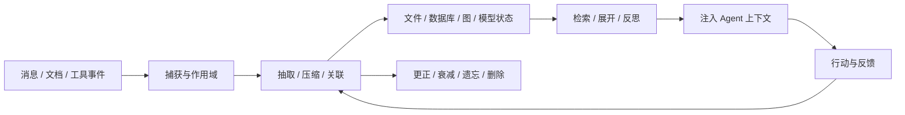

# awesome_agent_memory

**开源 AI Agent 记忆系统、文件记忆、图谱记忆、编码助手插件、研究实现与评测合集。**

Curated open-source memory systems, file-backed memory, temporal knowledge graphs, coding-agent integrations, procedural memory, and benchmarks for AI agents — with evidence-linked descriptions and reproducible GitHub maintenance rankings.

这里的“记忆”覆盖从交互捕获、事实/经历抽取、存储和作用域，到检索、反思、纠错、遗忘、删除与宿主注入的完整生命周期。普通向量数据库和只保留当前对话的短期缓存不单独收录。

[分类目录](#分类目录) · [项目详表](docs/projects.md) · [排序视图](docs/rankings.md) · [方法](docs/methodology.md) · [检索记录](docs/research.md) · [贡献](CONTRIBUTING.md)



分类描述的是项目主要职责，不表示功能互斥。首版追求可复核的生态地图，不声称穷尽全网项目。

## 当前收录

**87 个项目，其中 54 个来自三份原始调研，33 个为本轮新增。** 功能核验：2026-11-12；指标快照：`2026-11-12T08:37:55+00:00`（UTC）。

每个分类先按维护状态分层，再综合 star（40%）、90 天默认分支提交（35%）和最近提交（25%）排序。归档项目后置。维护分只描述 GitHub 热度与活动迹象，不代表记忆准确率、成本、安全性或生产成熟度。

## 活跃核心项目速览

只展示核心候选、许可证已核验且近 90 天有提交的项目；研究实现、检索组件、受限许可和历史项目不进入此表。

| 项目 | 定位 | Stars | 90天提交 | 最近提交 UTC | 维护分 |
| --- | --- | --- | --- | --- | --- |
| [claude-mem](https://github.com/thedotmack/claude-mem) | 捕获会话与工具活动，压缩入 SQLite/FTS5/Chroma 并在后续会话召回。 | 116,345 | 2,184 | 2026-11-12 | 100.0 |
| [Hindsight](https://github.com/vectorize-io/hindsight) | 通过 retain、recall 和 reflect 管理结构化事实、经历、实体与综合观察。 | 60,581 | 1,606 | 2026-11-11 | 98.1 |
| [OpenViking](https://github.com/volcengine/OpenViking) | 用可导航的虚拟文件系统统一管理资源、长期记忆与 Agent Skills。 | 42,049 | 1,250 | 2026-11-12 | 97.0 |
| [Cognee](https://github.com/topoteretes/cognee) | 把文档、代码与对话转为实体关系和可搜索知识/记忆图。 | 33,262 | 2,658 | 2026-11-06 | 94.7 |
| [Engram · Gentleman Programming](https://github.com/Gentleman-Programming/engram) | 面向编码 Agent 的 Go/SQLite/FTS5 持久记忆，提供 MCP、HTTP、CLI 与 TUI。 | 7,938 | 940 | 2026-11-11 | 91.0 |
| [agentmemory · rohitg00](https://github.com/rohitg00/agentmemory) | 面向编码 Agent 的服务与插件，融合 BM25、可选向量和结构关系。 | 30,310 | 210 | 2026-11-11 | 90.8 |
| [Basic Memory](https://github.com/basicmachines-co/basic-memory) | 把可编辑 Markdown 笔记和语义关系作为人机共用知识记忆。 | 4,557 | 872 | 2026-11-11 | 89.1 |
| [Supermemory](https://github.com/supermemoryai/supermemory) | 面向文档、记忆和用户画像的混合搜索与记忆平台。 | 31,596 | 141 | 2026-11-11 | 88.6 |
| [Mnemosyne · mnemosyne-oss](https://github.com/mnemosyne-oss/mnemosyne) | SQLite 驱动、默认本地的跨框架记忆层，支持 MCP 和多种 Agent 集成。 | 3,628 | 939 | 2026-11-12 | 88.5 |
| [Honcho](https://github.com/plastic-labs/honcho) | 围绕 peer、session 与 workspace 持续形成对象表征和协作理解。 | 8,084 | 304 | 2026-11-11 | 88.3 |
| [Mem0](https://github.com/mem0ai/mem0) | 通用个性化记忆层，支持从交互抽取、更新、删除与检索记忆。 | 68,846 | 101 | 2026-11-06 | 88.2 |
| [Graphiti](https://github.com/getzep/graphiti) | 实时抽取实体与关系，构建双时态知识图谱并融合词法、向量与图检索。 | 32,769 | 116 | 2026-11-11 | 87.6 |

## 分类目录

`★报告基线` 表示项目来自用户提供的三份调研。每项只有一个主分类，避免同一仓库重复参与排序。

| 分类 | 数量 | 维护排序靠前的项目 |
| --- | --- | --- |
| 记忆引擎与服务 | 26 | Hindsight、OpenViking、agentmemory · rohitg00 |
| 文件真源与可审阅记忆 | 11 | Engram · Gentleman Programming、Basic Memory、Mnemosyne · mnemosyne-oss |
| 图谱、实体与时序记忆 | 8 | Cognee、Graphiti、CortexDB |
| 编码 Agent 与 MCP 记忆 | 9 | claude-mem、MCP Memory Service、Memorix |
| 经验、技能与程序性记忆 | 5 | memU、Mengram、LangMem |
| 研究实现与评测 | 19 | OWASP Agent Memory Guard、Agent Memory Benchmarks、MemForest · Concyclics |
| 相邻平台、规范与索引 | 5 | QMD、Letta / MemGPT、Awesome Agent Memory · mnemoverse |
| 历史、归档与受限许可 | 4 | Engram App、Katra、Zep Legacy Community Edition |

### 记忆引擎与服务

| 项目 | 定位 | Stars | 90天提交 | 最近提交 UTC | 维护分 | 许可 |
| --- | --- | --- | --- | --- | --- | --- |
| [Hindsight](https://github.com/vectorize-io/hindsight) · ★报告基线 | 通过 retain、recall 和 reflect 管理结构化事实、经历、实体与综合观察。 | 60,581 | 1,606 | 2026-11-11 | 98.1 | MIT |
| [OpenViking](https://github.com/volcengine/OpenViking) · ★报告基线 | 用可导航的虚拟文件系统统一管理资源、长期记忆与 Agent Skills。 | 42,049 | 1,250 | 2026-11-12 | 97.0 | AGPL-3.0 |
| [agentmemory · rohitg00](https://github.com/rohitg00/agentmemory) · ★报告基线 | 面向编码 Agent 的服务与插件，融合 BM25、可选向量和结构关系。 | 30,310 | 210 | 2026-11-11 | 90.8 | Apache-2.0 |
| [Supermemory](https://github.com/supermemoryai/supermemory) · ★报告基线 | 面向文档、记忆和用户画像的混合搜索与记忆平台。 | 31,596 | 141 | 2026-11-11 | 88.6 | MIT |
| [Honcho](https://github.com/plastic-labs/honcho) · ★报告基线 | 围绕 peer、session 与 workspace 持续形成对象表征和协作理解。 | 8,084 | 304 | 2026-11-11 | 88.3 | AGPL-3.0 |
| [Mem0](https://github.com/mem0ai/mem0) · ★报告基线 | 通用个性化记忆层，支持从交互抽取、更新、删除与检索记忆。 | 68,846 | 101 | 2026-11-06 | 88.2 | Apache-2.0 |
| [Hy-Memory](https://github.com/Tencent-Hunyuan/Hy-Memory) | 面向对话、Agent 和编码场景的双系统认知记忆引擎与 Python SDK。 | 2,031 | 585 | 2026-11-12 | 86.4 | Apache-2.0 |
| [MemOS](https://github.com/MemTensor/MemOS) · ★报告基线 | 面向 Agent 的记忆操作系统，覆盖多类记忆、混合检索与技能演化。 | 12,366 | 176 | 2026-11-09 | 86.1 | Apache-2.0 |
| [TencentDB Agent Memory](https://github.com/TencentCloud/TencentDB-Agent-Memory) | 把对话、文档和代码沉淀为 Chat Memory、Skill、LLM-Wiki 与 Code-Graph 的团队记忆中心。 | 30,805 | 67 | 2026-11-10 | 84.2 | MIT |
| [Remnic](https://github.com/joshuaswarren/remnic) | 强调作用域、来源、更正、边界、检索质量和 MCP/HTTP 的用户感知记忆层。 | 232 | 1,083 | 2026-11-12 | 78.9 | MIT |
| [LongMemory](https://github.com/CaviraOSS/LongMemory) · ★报告基线 | 本地 TypeScript/SQLite 长期记忆，提供来源、时间、证据选择与 token 预算。 | 4,574 | 38 | 2026-11-10 | 74.3 | Apache-2.0 |
| [MIRIX](https://github.com/Mirix-AI/MIRIX) · ★报告基线 | 多类型、多 Agent、多模态长期记忆系统，可跟踪工作活动并提炼技能。 | 3,464 | 28 | 2026-11-11 | 72.0 | Apache-2.0 |
| [MemMachine](https://github.com/MemMachine/MemMachine) · ★报告基线 | 提供用户、项目与会话维度接口的通用 Agent 记忆服务。 | 3,086 | 41 | 2026-11-02 | 71.4 | Apache-2.0 |
| [Membase · unibase](https://github.com/unibaseio/membase) | 提供 SDK、CLI 和 MCP 的跨 Agent 记忆层，可使用托管账户或本地存储。 | 140 | 131 | 2026-11-10 | 69.1 | MIT |
| [openJiuwen Agent Memory](https://github.com/openJiuwen-ai/agent-memory) | 为 Agent 提供记忆抽取、存储、检索、迁移和多形态记忆能力。 | 83 | 157 | 2026-11-12 | 68.9 | Apache-2.0 |
| [mem9](https://github.com/mem9-ai/mem9) · ★报告基线 | 提供跨 Agent 记忆与会话摄入，并支持多种服务端存储后端。 | 1,237 | 24 | 2026-11-04 | 65.7 | Apache-2.0 |
| [Agent Memory Lab](https://github.com/agent-memory-lab/agent-memory) · ★报告基线 | 强调来源证据、事实更正、时间有效性和作用域的记忆引擎。 | 7 | 259 | 2026-11-10 | 62.9 | Apache-2.0 |
| [Memori](https://github.com/MemoriLabs/Memori) · ★报告基线 | 围绕用户与进程归属，将记忆摄入和回忆接入现有 LLM 调用。 | 17,558 | 3 | 2026-09-18 | 55.3 | Apache-2.0 |
| [Engram · TAIPANBOX](https://github.com/TAIPANBOX/engram) · ★报告基线 | 以 SQLite 承载情景、语义、程序记忆、双时态事实、衰减与 MCP。 | 4 | 40 | 2026-11-11 | 51.3 | Apache-2.0 |
| [Agent MemoryForge](https://github.com/hellangleZ/Agent-MemoryForge) | 面向多租户 Agent 的持久、可检索、可审计记忆层与 SDK/Gateway。 | 178 | 3 | 2026-09-29 | 41.1 | MIT |
| [Memvid](https://github.com/memvid/memvid) · ★报告基线 | 以便携单文件和 Rust 核心提供混合检索及多语言 SDK。 | 17,395 | 0 | 2026-07-14 | 40.5 | Apache-2.0 |
| [Memobase](https://github.com/memodb-io/memobase) · ★报告基线 | 围绕用户画像与时间事件维护长期用户记忆。 | 2,957 | 0 | 2026-01-11 | 28.6 | Apache-2.0 |
| [Engram · HBarefoot](https://github.com/HBarefoot/engram) · ★报告基线 | 进程内 TypeScript/SQLite 记忆库，提供本地 embedding、MCP 与使用 Skill。 | 9 | 0 | 2026-07-07 | 14.0 | MIT |
| [agent-memory · ivanzwb](https://github.com/ivanzwb/agent-memory) · ★报告基线 | TypeScript 嵌入式记忆库，包含工作、会话、长期记忆与知识库。 | 4 | 0 | 2026-04-13 | 7.9 | MIT |
| [MEMANTO](https://github.com/Jahvis/memanto-ai-memory) · ★报告基线 | 以 remember、recall、answer 原语封装带版本与来源元数据的记忆服务。 | 1 | 0 | 2026-06-05 | 6.7 | MIT |
| [OpenMemory · tawanorg](https://github.com/tawanorg/OpenMemory) | 框架无关的自托管长期语义与上下文记忆服务。 | 1 | 0 | 2025-10-26 | 2.8 | MIT |

### 文件真源与可审阅记忆

| 项目 | 定位 | Stars | 90天提交 | 最近提交 UTC | 维护分 | 许可 |
| --- | --- | --- | --- | --- | --- | --- |
| [Engram · Gentleman Programming](https://github.com/Gentleman-Programming/engram) | 面向编码 Agent 的 Go/SQLite/FTS5 持久记忆，提供 MCP、HTTP、CLI 与 TUI。 | 7,938 | 940 | 2026-11-11 | 91.0 | MIT |
| [Basic Memory](https://github.com/basicmachines-co/basic-memory) · ★报告基线 | 把可编辑 Markdown 笔记和语义关系作为人机共用知识记忆。 | 4,557 | 872 | 2026-11-11 | 89.1 | AGPL-3.0 |
| [Mnemosyne · mnemosyne-oss](https://github.com/mnemosyne-oss/mnemosyne) | SQLite 驱动、默认本地的跨框架记忆层，支持 MCP 和多种 Agent 集成。 | 3,628 | 939 | 2026-11-12 | 88.5 | MIT |
| [agent-memory · tigerless](https://github.com/tigerless-labs/agent-memory) · ★报告基线 | 以 Markdown 为真源、SQLite 为可重建索引，并提供独立休眠整理层。 | 4,315 | 381 | 2026-11-12 | 87.5 | MIT |
| [ReMe](https://github.com/agentscope-ai/ReMe) · ★报告基线 | 以 Markdown/frontmatter/wikilinks 组织事实与经验，支持词法、向量和关系扩展。 | 3,795 | 194 | 2026-11-12 | 83.3 | Apache-2.0 |
| [EverOS](https://github.com/EverMind-AI/EverOS) · ★报告基线 | 以 Markdown 真源和本地索引管理用户 episodes/profile 与 Agent cases/skills。 | 13,891 | 86 | 2026-11-11 | 83.0 | Apache-2.0 |
| [MemSearch](https://github.com/zilliztech/memsearch) · ★报告基线 | Markdown 真源配合 Milvus 派生索引，支持向量/BM25/RRF 与渐进展开。 | 2,863 | 74 | 2026-11-10 | 76.4 | MIT |
| [Sibyl Memory](https://github.com/Sibyl-Labs/Sibyl-Memory) | 单文件、无向量数据库的长期记忆家族，含 SDK、CLI、MCP、Hermes 与 LangGraph 适配。 | 176 | 38 | 2026-11-03 | 61.2 | MIT |
| [Agent Memory Vault](https://github.com/mcncarl/agent-memory-vault) | Markdown 优先的 Claude Code/Codex 共享记忆库，带 Git、索引和审计。 | 347 | 4 | 2026-10-04 | 45.6 | MIT |
| [Engram · shiblon](https://github.com/shiblon/engram) · ★报告基线 | 单二进制与 SQLite 管理短期/长期记忆、偏好和人格。 | 19 | 24 | 2026-10-06 | 45.0 | Apache-2.0 |
| [Engram · B12Labs](https://github.com/B12Labs/engram) · ★报告基线 | 便携单文件记忆格式，提供图压缩和快/混合/深度搜索。 | 1 | 0 | 2026-04-15 | 4.8 | MIT |

### 图谱、实体与时序记忆

| 项目 | 定位 | Stars | 90天提交 | 最近提交 UTC | 维护分 | 许可 |
| --- | --- | --- | --- | --- | --- | --- |
| [Cognee](https://github.com/topoteretes/cognee) · ★报告基线 | 把文档、代码与对话转为实体关系和可搜索知识/记忆图。 | 33,262 | 2,658 | 2026-11-06 | 94.7 | Apache-2.0 |
| [Graphiti](https://github.com/getzep/graphiti) · ★报告基线 | 实时抽取实体与关系，构建双时态知识图谱并融合词法、向量与图检索。 | 32,769 | 116 | 2026-11-11 | 87.6 | Apache-2.0 |
| [CortexDB](https://github.com/liliang-cn/cortexdb) | 在单个 SQLite 文件中结合知识图谱、约束和可追溯推理。 | 480 | 560 | 2026-11-10 | 81.0 | MIT |
| [Neo4j Agent Memory](https://github.com/neo4j-labs/agent-memory) | 基于图的 Agent 记忆与 context graph，存储对话、实体、关系和推理轨迹。 | 607 | 269 | 2026-10-27 | 74.8 | Apache-2.0 |
| [Memoir](https://github.com/zhangfengcdt/memoir) | 带 Git 式版本控制的分层 Agent 记忆。 | 631 | 34 | 2026-10-27 | 63.3 | Apache-2.0 |
| [Lemmalog](https://github.com/JordyZomer/lemmalog) | 用 Datalog 规则、来源事实和增量推导构建 Agent 记忆。 | 347 | 47 | 2026-10-01 | 57.8 | MIT |
| [Memory Graph](https://github.com/memory-graph/memory-graph) | 为编码 Agent 提供关系跟踪与图查询的 MCP 记忆服务。 | 258 | 12 | 2026-09-16 | 47.1 | MIT |
| [M-flow](https://github.com/FlowElement-xinliuyuansu/m_flow) | 以多层认知图和受控传播组织情景、概念与实体记忆。 | 4,511 | 0 | 2026-08-03 | 37.4 | Apache-2.0 |

### 编码 Agent 与 MCP 记忆

| 项目 | 定位 | Stars | 90天提交 | 最近提交 UTC | 维护分 | 许可 |
| --- | --- | --- | --- | --- | --- | --- |
| [claude-mem](https://github.com/thedotmack/claude-mem) · ★报告基线 | 捕获会话与工具活动，压缩入 SQLite/FTS5/Chroma 并在后续会话召回。 | 116,345 | 2,184 | 2026-11-12 | 100.0 | Apache-2.0 |
| [MCP Memory Service](https://github.com/doobidoo/mcp-memory-service) · ★报告基线 | 通过 MCP/REST 提供语义记忆、关系和后台整理，并支持多种存储后端。 | 2,116 | 774 | 2026-11-12 | 86.5 | Apache-2.0 |
| [Memorix](https://github.com/AVIDS2/memorix) | 通过 MCP 为多种编码 Agent 提供跨宿主共享记忆。 | 928 | 250 | 2026-11-11 | 79.5 | Apache-2.0 |
| [OKF Agent Memory](https://github.com/okf-memory/okf-agent-memory) | Git-native 编码 Agent 记忆，提供嵌入式 MCP 与渐进式读取。 | 864 | 242 | 2026-11-05 | 77.7 | MIT |
| [projectmem](https://github.com/riponcm/projectmem) · ★报告基线 | 以事件日志记录 issue、尝试、修复和决策，避免编码 Agent 重复失败。 | 880 | 105 | 2026-11-01 | 72.1 | MIT |
| [Mnemoverse Memory Server](https://github.com/mnemoverse/mcp-memory-server) | 通过 MCP 提供托管持久记忆、反馈重排和多 Agent 共享房间。 | 28 | 151 | 2026-11-11 | 64.8 | MIT |
| [Codex Honcho](https://github.com/plastic-labs/codex-honcho) · ★报告基线 | 把 Codex 会话、工具活动和上下文注入接入 Honcho 的官方集成。 | 66 | 1 | 2026-09-01 | 29.8 | MIT |
| [MegaMemory](https://github.com/0xK3vin/MegaMemory) | 面向编码 Agent 的持久项目知识图谱、语义搜索和 MCP 服务。 | 736 | 0 | 2026-05-03 | 25.9 | MIT |
| [mcp-mem0](https://github.com/coleam00/mcp-mem0) | 把 Mem0 长期记忆封装为 MCP 服务供 Agent 客户端使用。 | 688 | 0 | 2025-04-13 | 22.8 | MIT |

### 经验、技能与程序性记忆

| 项目 | 定位 | Stars | 90天提交 | 最近提交 UTC | 维护分 | 许可 |
| --- | --- | --- | --- | --- | --- | --- |
| [memU](https://github.com/NevaMind-AI/memU) · ★报告基线 | 跨 Agent 个人记忆与宿主桥接，支持 Agent 提炼 Markdown 和记忆 Skill。 | 14,618 | 52 | 2026-11-10 | 80.2 | Apache-2.0 |
| [Mengram](https://github.com/alibaizhanov/mengram) · ★报告基线 | 组织语义、情景与程序记忆，并用失败反馈改进工作流程。 | 207 | 116 | 2026-11-09 | 69.6 | Apache-2.0 |
| [LangMem](https://github.com/langchain-ai/langmem) · ★报告基线 | 从对话抽取长期事实、搜索记忆，并通过经历优化 Agent 行为。 | 1,763 | 11 | 2026-11-03 | 62.6 | MIT |
| [Engram · vincents-ai](https://github.com/vincents-ai/engram) · ★报告基线 · 许可注意 | 面向多 Agent 的分布式项目上下文、任务、推理与团队知识。 | 24 | 19 | 2026-11-01 | 50.2 | AGPL-3.0-or-later 或商业许可 |
| [Acontext](https://github.com/memodb-io/Acontext) · ★报告基线 · 归档/历史 | 从 Agent 执行与产物中提炼可读、可编辑的操作经验与 Skill。 | 3,696 | 2 | 2026-10-24 | 55.0 | Apache-2.0 |

### 研究实现与评测

| 项目 | 定位 | Stars | 90天提交 | 最近提交 UTC | 维护分 | 许可 |
| --- | --- | --- | --- | --- | --- | --- |
| [OWASP Agent Memory Guard](https://github.com/OWASP/www-project-agent-memory-guard) | 面向 Agent 记忆与上下文污染的运行时防护和参考实现。 | 201 | 283 | 2026-11-12 | 75.2 | Apache-2.0 |
| [Agent Memory Benchmarks](https://github.com/RonsenbergVI/agent-memory-benchmarks) | 提供 LongMemEval、LoCoMo 等 Agent 记忆系统的开放评测与参考实现。 | 2 | 339 | 2026-11-09 | 60.9 | MIT |
| [MemForest · Concyclics](https://github.com/Concyclics/MemForest) · ★报告基线 | 使用分层时间索引组织长期记忆并提供 Python 实验接口。 | 36 | 34 | 2026-11-11 | 57.4 | MIT |
| [MemT-1.0](https://github.com/MemTensor/MemT-1.0) · 许可注意 | 探索模型原生记忆读写与 Mixture-of-Storage 的记忆模型家族。 | 533 | 6 | 2026-11-08 | 56.6 | PolyForm Noncommercial-1.0.0 |
| [Agent Memory Leaderboard](https://github.com/AML-memory/agent-memory-leaderboard) · 许可注意 | 收集 Agent 记忆系统评测结果和比较资料。 | 1,119 | 3 | 2026-11-02 | 54.6 | 待核验 |
| [Agent Memory Radar](https://github.com/H20Zhang/Agent-Memory-Radar) · 许可注意 | 整理记忆机制、基准、污染、遗忘和恢复证据的研究雷达。 | 3 | 181 | 2026-09-11 | 46.6 | CC-BY-4.0 内容 / MIT 代码 |
| [MemoryAgentBench](https://github.com/HUST-AI-HYZ/MemoryAgentBench) · ★报告基线 | 通过增量多轮交互评测 Agent 记忆构建和使用能力。 | 487 | 5 | 2026-09-25 | 46.2 | MIT |
| [MemSkill](https://github.com/ViktorAxelsen/MemSkill) | 把抽取、整合、剪枝等记忆操作建模为可学习、可演化的 Skill。 | 603 | 3 | 2026-10-01 | 45.8 | Apache-2.0 |
| [T-Mem](https://github.com/Sherlockwz/T-Mem) · ★报告基线 | 写入时生成未来查询触发线索，结合事实与场景索引研究联想式召回。 | 199 | 5 | 2026-09-09 | 40.8 | MIT |
| [MemForest · EventTree](https://github.com/Celina-love-sweet/MemForest) · ★报告基线 | 通过 EventTree 分段、渐进合并和压缩长期记忆。 | 52 | 4 | 2026-09-17 | 36.3 | MIT |
| [MemoryStackBench](https://github.com/aetna000/MemoryStackBench) | 自动化评测 Agent 记忆安全、证据、删除完整性和可审计性。 | 6 | 6 | 2026-09-11 | 30.3 | Apache-2.0 |
| [SimpleMem](https://github.com/aiming-lab/SimpleMem) · ★报告基线 | 研究语义结构化压缩、记忆整合和自适应检索。 | 3,873 | 0 | 2026-07-24 | 36.0 | MIT |
| [MemoryOS](https://github.com/BAI-LAB/MemoryOS) · ★报告基线 | 研究短、中、长期分层记忆、更新与用户画像管理。 | 1,621 | 0 | 2026-07-07 | 31.7 | Apache-2.0 |
| [A-MEM](https://github.com/agiresearch/A-mem) · ★报告基线 | 借鉴 Zettelkasten 自动组织、关联和演化记忆笔记。 | 1,214 | 0 | 2025-12-12 | 25.3 | MIT |
| [agentmemory · JordanMcCann](https://github.com/JordanMcCann/agentmemory) · ★报告基线 | 研究语义、词法、图、重要性和时间等多信号检索。 | 46 | 0 | 2026-03-26 | 15.3 | MIT |
| [MPBench](https://github.com/Digital-Trust-Lab/mp-bench) | 评测持久记忆写入、后续检索和行为触发的记忆污染攻击数据集。 | 7 | 0 | 2026-06-28 | 12.7 | Apache-2.0 |
| [agent-memory-bench](https://github.com/thomasfevre/agent-memory-bench) · 许可注意 | 强调证据命中、答案和检索行为的可复查记忆评测。 | 0 | 0 | 2026-07-30 | 7.8 | 待核验 |
| [MemEngine](https://github.com/nuster1128/MemEngine) · ★报告基线 · 许可注意 | 模块化 Agent 记忆研究库，覆盖多类记忆模块与评测。 | 116 | 0 | 2025-05-13 | 16.6 | 待核验 |
| [MemoryBank / SiliconFriend](https://github.com/zhongwanjun/MemoryBank-SiliconFriend) · ★报告基线 · 归档/历史 | 长期交互、用户画像、记忆强化和遗忘的早期研究实现。 | 458 | 0 | 2023-05-24 | 21.3 | MIT |

### 相邻平台、规范与索引

| 项目 | 定位 | Stars | 90天提交 | 最近提交 UTC | 维护分 | 许可 |
| --- | --- | --- | --- | --- | --- | --- |
| [QMD](https://github.com/tobi/qmd) · ★报告基线 | 为本地 Markdown 和文档提供 BM25、向量、查询扩展、rerank 与 MCP。 | 31,069 | 118 | 2026-10-15 | 81.1 | MIT |
| [Letta / MemGPT](https://github.com/letta-ai/letta) · ★报告基线 | 以持久状态和 Agent 自主管理上下文为核心的完整 Agent 平台。 | 25,421 | 6 | 2026-10-18 | 65.3 | Apache-2.0 |
| [Awesome Agent Memory · mnemoverse](https://github.com/mnemoverse/awesome-agent-memory) | 整理 Agent 记忆系统、框架、基准和研究的外部索引。 | 66 | 73 | 2026-11-10 | 63.5 | CC0-1.0 |
| [MineContext](https://github.com/volcengine/MineContext) · ★报告基线 | 通过屏幕等数字上下文生成活动、总结和可查询资料。 | 5,547 | 0 | 2026-05-07 | 33.0 | Apache-2.0 |
| [MCP Memory Server](https://github.com/modelcontextprotocol/servers) · ★报告基线 · 归档/历史 · 许可注意 | 官方 MCP servers 父仓库中的 entities、relations、observations 记忆组件。 | 91,941 | 1,036 | 2026-11-11 | 99.4 | Apache-2.0 / MIT 过渡；文档 CC-BY-4.0 |

### 历史、归档与受限许可

| 项目 | 定位 | Stars | 90天提交 | 最近提交 UTC | 维护分 | 许可 |
| --- | --- | --- | --- | --- | --- | --- |
| [Engram App](https://github.com/engram-app/Engram) · ★报告基线 · 许可注意 | 提供认知记忆与 Agent 集成的源码可见项目。 | 2 | 704 | 2026-11-12 | 63.8 | PolyForm Small Business-1.0.0 / 商业许可 |
| [Katra](https://github.com/kolegadev/Katra-Agentic-Memory) · 许可注意 | 提供情景、语义、图谱和休眠整合的 MCP 认知记忆设备。 | 9 | 183 | 2026-10-29 | 58.8 | BSL-1.1 |
| [Zep Legacy Community Edition](https://github.com/getzep/zep) · ★报告基线 · 归档/历史 | Zep 旧 Community Edition 与当前云产品集成示例。 | 5,005 | 28 | 2026-11-04 | 71.6 | Apache-2.0 |
| [Engram · Agentscreator](https://github.com/Agentscreator/engram-memory) · ★报告基线 · 归档/历史 | 面向多 Agent 共享记忆、冲突和一致性的归档项目。 | 81 | 0 | 2026-05-23 | 18.9 | Apache-2.0 |

## 选择入口

- 需要完整外置记忆 API：先看记忆引擎与服务。
- 需要可直接审阅、修改、Git 管理：看文件真源记忆。
- 需要实体关系、时间有效性和多跳：看图谱与时序记忆。
- 需要 Claude Code、Codex、OpenCode 等跨宿主记忆：看编码 Agent/MCP。
- 需要把成功与失败沉淀成可执行方法：看经验、技能与程序性记忆。
- 需要验证效果、污染、删除与遗忘：看研究实现与评测。

完整边界和证据见 [项目详表](docs/projects.md)，分类口径见 [范围与分类](docs/taxonomy.md)。

## 数据与维护

- [综合、Star、活跃度、最近提交排序](docs/rankings.md)
- [排序方法与限制](docs/methodology.md)
- [检索关键词、来源与覆盖](docs/research.md)
- [项目 JSON](data/projects.json) · [指标 JSON](data/metrics.json) · [排序 CSV](data/rankings.csv)
- [贡献指南](CONTRIBUTING.md)

```sh
python scripts/refresh_metrics.py
python scripts/build.py
python -m unittest discover -s tests -v
python scripts/build.py --check
```

GitHub Actions 每日刷新 GitHub 指标。新增项目、功能、分类和许可判断必须人工核验。

## 许可与致谢

本目录的原创整理和脚本采用 [MIT](LICENSE)，所链接项目遵循各自许可。未知、复合、非商业或 BSL/PolyForm 项目均保留原始边界。

初始分类与项目地图来自用户提供的三份本地调研；本轮另参考 [mnemoverse/awesome-agent-memory](https://github.com/mnemoverse/awesome-agent-memory) 进行覆盖校验，并回到各项目官方仓库核验。
