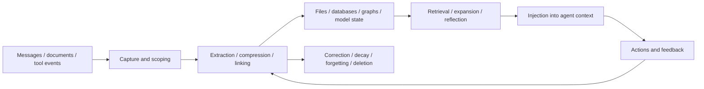

🌐 **English** · [简体中文](locales/zh/README.md) · [Español](locales/es/README.md) · [हिन्दी](locales/hi/README.md) · [Français](locales/fr/README.md)

# awesome_agent_memory

**Curated open-source AI agent memory systems, file-backed memory, graph memory, coding-assistant plugins, research implementations and benchmarks — with evidence-linked descriptions and reproducible GitHub maintenance rankings.**

"Memory" here spans the full lifecycle: interaction capture, fact/experience extraction, storage and scoping, through retrieval, reflection, correction, forgetting, deletion and host injection. Plain vector databases and short-lived caches that only keep the current conversation are not catalogued on their own.

[Category index](#category-index) · [Project details](docs/projects.md) · [Rankings](docs/rankings.md) · [Methodology](docs/methodology.md) · [Research log](docs/research.md) · [Contributing](CONTRIBUTING.md)



Categories describe a project's primary responsibility, not mutually exclusive capabilities. The first release aims for a verifiable ecosystem map; it does not claim to cover every project on the internet.

## Jump to a category

[Memory engines and services](#memory-engines-and-services) · [File-backed source-of-truth and auditable memory](#file-backed-source-of-truth-and-auditable-memory) · [Graphs, entities and temporal memory](#graphs-entities-and-temporal-memory) · [Coding agents and MCP memory](#coding-agents-and-mcp-memory) · [Experience, skills and procedural memory](#experience-skills-and-procedural-memory) · [Research implementations and benchmarks](#research-implementations-and-benchmarks) · [Adjacent platforms, specifications and indexes](#adjacent-platforms-specifications-and-indexes) · [Historical, archived and restricted licenses](#historical-archived-and-restricted-licenses)

## Current coverage

**89 projects, of which 54 come from the three original research reports and 35 were added in this round.** Feature verification: 2026-11-20; metrics snapshot: `2026-11-27T10:10:59+00:00` (UTC).

Within each category, projects are first tiered by maintenance status, then ranked by a blend of stars (40%), 90-day default-branch commits (35%) and recency of the last commit (25%). Archived projects are placed last. The maintenance score describes GitHub popularity and activity signals only; it does not represent memory accuracy, cost, safety or production maturity.

## Active core projects at a glance

Shows only core candidates with a verified license and commits in the last 90 days; research implementations, retrieval components, restricted-license and historical projects are excluded from this table.

| Project | Positioning | Stars | 90-day commits | Last commit (UTC) | Maintenance score |
| --- | --- | --- | --- | --- | --- |
| [claude-mem](https://github.com/thedotmack/claude-mem) | Captures sessions and tool activity, compresses them into SQLite/FTS5/Chroma and recalls them in later sessions. | 120,087 | 2,579 | 2026-11-26 | 99.8 |
| [Hindsight](https://github.com/vectorize-io/hindsight) | Manages structured facts, experiences, entities and synthesized observations through retain, recall and reflect. | 63,782 | 1,659 | 2026-11-27 | 98.4 |
| [OpenViking](https://github.com/volcengine/OpenViking) | Manages resources, long-term memory and Agent Skills through a navigable virtual file system. | 42,915 | 1,484 | 2026-11-27 | 97.1 |
| [Cognee](https://github.com/topoteretes/cognee) | Turns documents, code and conversations into entity relations and searchable knowledge/memory graphs. | 33,666 | 3,060 | 2026-11-26 | 96.1 |
| [Engram · Gentleman Programming](https://github.com/Gentleman-Programming/engram) | Go/SQLite/FTS5 persistent memory for coding agents with MCP, HTTP, CLI and TUI. | 8,331 | 823 | 2026-11-24 | 90.5 |
| [Graphiti](https://github.com/getzep/graphiti) | Extracts entities and relations in real time, builds a bi-temporal knowledge graph and blends lexical, vector and graph retrieval. | 33,135 | 164 | 2026-11-26 | 89.8 |
| [Basic Memory](https://github.com/basicmachines-co/basic-memory) | Editable Markdown notes and semantic relations as shared human-machine knowledge memory. | 4,731 | 805 | 2026-11-27 | 89.4 |
| [agentmemory · rohitg00](https://github.com/rohitg00/agentmemory) | Service and plugin for coding agents combining BM25, optional vectors and structural relations. | 30,612 | 233 | 2026-11-18 | 89.2 |
| [Honcho](https://github.com/plastic-labs/honcho) | Continuously forms peer representations and collaborative understanding around peers, sessions and workspaces. | 8,308 | 317 | 2026-11-25 | 88.4 |
| [Mnemosyne · mnemosyne-oss](https://github.com/mnemosyne-oss/mnemosyne) | SQLite-backed, default-local cross-framework memory layer with MCP and multiple agent integrations. | 3,711 | 920 | 2026-11-26 | 88.4 |
| [Supermemory](https://github.com/supermemoryai/supermemory) | Hybrid search and memory platform for documents, memories and user profiles. | 31,865 | 127 | 2026-11-24 | 87.7 |
| [Mem0](https://github.com/mem0ai/mem0) | General-purpose personalization memory layer supporting extraction, updating, deletion and retrieval of memories from interactions. | 69,532 | 67 | 2026-11-25 | 87.0 |

## Category index

`★Report baseline` marks projects coming from the three user-provided research reports. Each entry has exactly one primary category, so the same repository never enters the ranking twice.

| Category | Count | Top projects by maintenance rank |
| --- | --- | --- |
| Memory engines and services | 27 | Hindsight, OpenViking, agentmemory · rohitg00 |
| File-backed source-of-truth and auditable memory | 11 | Engram · Gentleman Programming, Basic Memory, Mnemosyne · mnemosyne-oss |
| Graphs, entities and temporal memory | 7 | Cognee, Graphiti, CortexDB |
| Coding agents and MCP memory | 10 | claude-mem, MCP Memory Service, dsh-mnemon |
| Experience, skills and procedural memory | 5 | memU, Mengram, LangMem |
| Research implementations and benchmarks | 19 | OWASP Agent Memory Guard, Agent Memory Leaderboard, MemT-1.0 |
| Adjacent platforms, specifications and indexes | 5 | QMD, Awesome Agent Memory · mnemoverse, Letta / MemGPT |
| Historical, archived and restricted licenses | 5 | Engram App, Katra, Zep Legacy Community Edition |

### Memory engines and services

| Project | Positioning | Stars | 90-day commits | Last commit (UTC) | Maintenance score | License |
| --- | --- | --- | --- | --- | --- | --- |
| [Hindsight](https://github.com/vectorize-io/hindsight) · ★Report baseline | Manages structured facts, experiences, entities and synthesized observations through retain, recall and reflect. | 63,782 | 1,659 | 2026-11-27 | 98.4 | MIT |
| [OpenViking](https://github.com/volcengine/OpenViking) · ★Report baseline | Manages resources, long-term memory and Agent Skills through a navigable virtual file system. | 42,915 | 1,484 | 2026-11-27 | 97.1 | AGPL-3.0 |
| [agentmemory · rohitg00](https://github.com/rohitg00/agentmemory) · ★Report baseline | Service and plugin for coding agents combining BM25, optional vectors and structural relations. | 30,612 | 233 | 2026-11-18 | 89.2 | Apache-2.0 |
| [Honcho](https://github.com/plastic-labs/honcho) · ★Report baseline | Continuously forms peer representations and collaborative understanding around peers, sessions and workspaces. | 8,308 | 317 | 2026-11-25 | 88.4 | AGPL-3.0 |
| [Supermemory](https://github.com/supermemoryai/supermemory) · ★Report baseline | Hybrid search and memory platform for documents, memories and user profiles. | 31,865 | 127 | 2026-11-24 | 87.7 | MIT |
| [Mem0](https://github.com/mem0ai/mem0) · ★Report baseline | General-purpose personalization memory layer supporting extraction, updating, deletion and retrieval of memories from interactions. | 69,532 | 67 | 2026-11-25 | 87.0 | Apache-2.0 |
| [Hy-Memory](https://github.com/Tencent-Hunyuan/Hy-Memory) | Dual-system cognitive memory engine and Python SDK for conversation, agent and coding scenarios. | 1,943 | 604 | 2026-11-18 | 84.0 | Apache-2.0 |
| [TencentDB Agent Memory](https://github.com/TencentCloud/TencentDB-Agent-Memory) | Team memory hub that turns conversations, documents and code into Chat Memory, Skills, LLM-Wiki and Code-Graph. | 31,221 | 60 | 2026-11-24 | 83.3 | MIT |
| [MemOS](https://github.com/MemTensor/MemOS) · ★Report baseline | Memory operating system for agents covering multiple memory types, hybrid retrieval and skill evolution. | 12,521 | 104 | 2026-11-09 | 79.5 | Apache-2.0 |
| [Remnic](https://github.com/joshuaswarren/remnic) | User-aware memory layer emphasizing scoping, provenance, corrections, boundaries, retrieval quality and MCP/HTTP. | 235 | 733 | 2026-11-27 | 79.0 | MIT |
| [MemMachine](https://github.com/MemMachine/MemMachine) · ★Report baseline | General-purpose agent memory service with user, project and session scoped interfaces. | 3,094 | 49 | 2026-11-26 | 74.6 | Apache-2.0 |
| [Mnemon](https://github.com/mnemon-dev/mnemon) | Cross-session persistent memory for agents, organizing knowledge in a graph structure with intent-aware retrieval and multiple host integrations. | 749 | 121 | 2026-11-23 | 74.0 | Apache-2.0 |
| [openJiuwen Agent Memory](https://github.com/openJiuwen-ai/agent-memory) | Provides agents with memory extraction, storage, retrieval, migration and multi-form memory capabilities. | 130 | 175 | 2026-11-27 | 71.0 | Apache-2.0 |
| [LongMemory](https://github.com/CaviraOSS/LongMemory) · ★Report baseline | Local TypeScript/SQLite long-term memory with provenance, timing, evidence selection and token budgets. | 4,590 | 19 | 2026-11-26 | 71.0 | Apache-2.0 |
| [Membase](https://github.com/membaseai/membase) | Cross-agent memory layer with SDK, CLI and MCP, using hosted accounts or local storage. | 143 | 168 | 2026-11-25 | 70.6 | MIT |
| [MIRIX](https://github.com/Mirix-AI/MIRIX) · ★Report baseline | Multi-type, multi-agent, multimodal long-term memory system that tracks work activity and distills skills. | 3,518 | 23 | 2026-11-11 | 67.2 | Apache-2.0 |
| [Agent Memory Lab](https://github.com/agent-memory-lab/agent-memory) · ★Report baseline | Memory engine emphasizing source evidence, fact correction, temporal validity and scoping. | 7 | 261 | 2026-11-14 | 60.2 | Apache-2.0 |
| [mem9](https://github.com/mem9-ai/mem9) · ★Report baseline | Cross-agent memory and session ingestion with multiple server-side storage backends. | 1,236 | 15 | 2026-11-04 | 59.7 | Apache-2.0 |
| [Memori](https://github.com/MemoriLabs/Memori) · ★Report baseline | Hooks memory ingestion and recall into existing LLM calls around user and process ownership. | 17,624 | 2 | 2026-09-18 | 51.6 | Apache-2.0 |
| [Engram · TAIPANBOX](https://github.com/TAIPANBOX/engram) · ★Report baseline | SQLite-backed episodic, semantic and procedural memory with bi-temporal facts, decay and MCP. | 6 | 33 | 2026-11-26 | 51.5 | Apache-2.0 |
| [Agent MemoryForge](https://github.com/hellangleZ/Agent-MemoryForge) | Persistent, searchable, auditable memory layer with SDK/Gateway for multi-tenant agents. | 178 | 3 | 2026-09-29 | 38.8 | MIT |
| [Memvid](https://github.com/memvid/memvid) · ★Report baseline | Hybrid retrieval and multilingual SDKs via a portable single file and a Rust core. | 17,438 | 0 | 2026-07-14 | 39.5 | Apache-2.0 |
| [Memobase](https://github.com/memodb-io/memobase) · ★Report baseline | Maintains long-term user memory around user profiles and timed events. | 2,968 | 0 | 2026-01-11 | 28.5 | Apache-2.0 |
| [Engram · HBarefoot](https://github.com/HBarefoot/engram) · ★Report baseline | In-process TypeScript/SQLite memory library with local embeddings, MCP and a usage Skill. | 9 | 0 | 2026-07-07 | 13.1 | MIT |
| [agent-memory · ivanzwb](https://github.com/ivanzwb/agent-memory) · ★Report baseline | Embedded TypeScript memory library with working, session and long-term memory plus a knowledge base. | 4 | 0 | 2026-04-13 | 7.6 | MIT |
| [MEMANTO](https://github.com/Jahvis/memanto-ai-memory) · ★Report baseline | Memory service wrapped around remember, recall and answer primitives, with versioning and source metadata. | 1 | 0 | 2026-06-05 | 6.0 | MIT |
| [OpenMemory · tawanorg](https://github.com/tawanorg/OpenMemory) | Framework-agnostic self-hosted long-term semantic and contextual memory service. | 1 | 0 | 2025-10-26 | 2.7 | MIT |

### File-backed source-of-truth and auditable memory

| Project | Positioning | Stars | 90-day commits | Last commit (UTC) | Maintenance score | License |
| --- | --- | --- | --- | --- | --- | --- |
| [Engram · Gentleman Programming](https://github.com/Gentleman-Programming/engram) | Go/SQLite/FTS5 persistent memory for coding agents with MCP, HTTP, CLI and TUI. | 8,331 | 823 | 2026-11-24 | 90.5 | MIT |
| [Basic Memory](https://github.com/basicmachines-co/basic-memory) · ★Report baseline | Editable Markdown notes and semantic relations as shared human-machine knowledge memory. | 4,731 | 805 | 2026-11-27 | 89.4 | AGPL-3.0 |
| [Mnemosyne · mnemosyne-oss](https://github.com/mnemosyne-oss/mnemosyne) | SQLite-backed, default-local cross-framework memory layer with MCP and multiple agent integrations. | 3,711 | 920 | 2026-11-26 | 88.4 | MIT |
| [EverOS](https://github.com/EverMind-AI/EverOS) · ★Report baseline | Manages user episodes/profiles and agent cases/skills with a Markdown source of truth and local indexes. | 14,015 | 122 | 2026-11-25 | 84.7 | Apache-2.0 |
| [agent-memory · tigerless](https://github.com/tigerless-labs/agent-memory) · ★Report baseline | Markdown as the source of truth with a rebuildable SQLite index and a separate sleep-time consolidation layer. | 3,963 | 381 | 2026-11-12 | 83.4 | MIT |
| [ReMe](https://github.com/agentscope-ai/ReMe) · ★Report baseline | Organizes facts and experiences with Markdown/frontmatter/wikilinks, supporting lexical, vector and relation expansion. | 3,859 | 187 | 2026-11-26 | 82.9 | Apache-2.0 |
| [MemSearch](https://github.com/zilliztech/memsearch) · ★Report baseline | Markdown source of truth plus a derived Milvus index, with vector/BM25/RRF retrieval and progressive expansion. | 2,950 | 68 | 2026-11-27 | 76.5 | MIT |
| [Sibyl Memory](https://github.com/Sibyl-Labs/Sibyl-Memory) | Single-file long-term memory family without a vector database, with SDK, CLI, MCP, Hermes and LangGraph adapters. | 191 | 40 | 2026-11-19 | 62.2 | MIT |
| [Agent Memory Vault](https://github.com/mcncarl/agent-memory-vault) | Markdown-first shared memory vault for Claude Code/Codex with Git, indexes and auditing. | 350 | 4 | 2026-10-04 | 43.1 | MIT |
| [Engram · shiblon](https://github.com/shiblon/engram) · ★Report baseline | Single binary with SQLite managing short- and long-term memory, preferences and persona. | 19 | 24 | 2026-10-06 | 42.5 | Apache-2.0 |
| [Engram · B12Labs](https://github.com/B12Labs/engram) · ★Report baseline | Portable single-file memory format with graph compression and fast/hybrid/deep search. | 1 | 0 | 2026-04-15 | 4.4 | MIT |

### Graphs, entities and temporal memory

| Project | Positioning | Stars | 90-day commits | Last commit (UTC) | Maintenance score | License |
| --- | --- | --- | --- | --- | --- | --- |
| [Cognee](https://github.com/topoteretes/cognee) · ★Report baseline | Turns documents, code and conversations into entity relations and searchable knowledge/memory graphs. | 33,666 | 3,060 | 2026-11-26 | 96.1 | Apache-2.0 |
| [Graphiti](https://github.com/getzep/graphiti) · ★Report baseline | Extracts entities and relations in real time, builds a bi-temporal knowledge graph and blends lexical, vector and graph retrieval. | 33,135 | 164 | 2026-11-26 | 89.8 | Apache-2.0 |
| [CortexDB](https://github.com/liliang-cn/cortexdb) | Combines a knowledge graph, constraints and traceable reasoning in a single SQLite file. | 532 | 596 | 2026-11-27 | 81.8 | MIT |
| [Neo4j Agent Memory](https://github.com/neo4j-labs/agent-memory) | Graph-based agent memory and context graph storing conversations, entities, relations and reasoning traces. | 617 | 201 | 2026-10-27 | 70.0 | Apache-2.0 |
| [Memoir](https://github.com/zhangfengcdt/memoir) | Layered agent memory with Git-style version control. | 648 | 33 | 2026-10-27 | 60.0 | Apache-2.0 |
| [Lemmalog](https://github.com/JordyZomer/lemmalog) | Builds agent memory from Datalog rules, source facts and incremental derivation. | 352 | 31 | 2026-10-01 | 53.1 | MIT |
| [Memory Graph](https://github.com/memory-graph/memory-graph) | MCP memory service with relation tracking and graph queries for coding agents. | 260 | 3 | 2026-09-16 | 38.4 | MIT |

### Coding agents and MCP memory

| Project | Positioning | Stars | 90-day commits | Last commit (UTC) | Maintenance score | License |
| --- | --- | --- | --- | --- | --- | --- |
| [claude-mem](https://github.com/thedotmack/claude-mem) · ★Report baseline | Captures sessions and tool activity, compresses them into SQLite/FTS5/Chroma and recalls them in later sessions. | 120,087 | 2,579 | 2026-11-26 | 99.8 | Apache-2.0 |
| [MCP Memory Service](https://github.com/doobidoo/mcp-memory-service) · ★Report baseline | Semantic memory, relations and background consolidation over MCP/REST with multiple storage backends. | 2,159 | 722 | 2026-11-27 | 86.7 | Apache-2.0 |
| [dsh-mnemon](https://github.com/omdsh-dev/dsh-mnemon) | Layered memory plugin for DeepSeek Harness combining runtime memory, project docs and swappable long-term memory backends. | 1,145 | 1,665 | 2026-11-26 | 84.3 | MIT |
| [OKF Agent Memory](https://github.com/okf-memory/okf-agent-memory) | Git-native coding-agent memory with an embedded MCP server and progressive reading. | 876 | 247 | 2026-11-21 | 78.0 | MIT |
| [Memorix](https://github.com/AVIDS2/memorix) | Cross-host shared memory for multiple coding agents over MCP. | 954 | 168 | 2026-11-19 | 75.6 | Apache-2.0 |
| [projectmem](https://github.com/riponcm/projectmem) · ★Report baseline | Event-log recording of issues, attempts, fixes and decisions so coding agents avoid repeating failures. | 886 | 123 | 2026-11-20 | 74.0 | MIT |
| [Mnemoverse Memory Server](https://github.com/mnemoverse/mcp-memory-server) | Hosted persistent memory over MCP with feedback reranking and multi-agent shared rooms. | 30 | 142 | 2026-11-18 | 62.6 | MIT |
| [Codex Honcho](https://github.com/plastic-labs/codex-honcho) · ★Report baseline | Official integration connecting Codex sessions, tool activity and context injection to Honcho. | 66 | 1 | 2026-09-01 | 28.1 | MIT |
| [MegaMemory](https://github.com/0xK3vin/MegaMemory) | Persistent project knowledge graph, semantic search and MCP service for coding agents. | 739 | 0 | 2026-05-03 | 25.4 | MIT |
| [mcp-mem0](https://github.com/coleam00/mcp-mem0) | Wraps Mem0 long-term memory as an MCP service for agent clients. | 686 | 0 | 2025-04-13 | 22.7 | MIT |

### Experience, skills and procedural memory

| Project | Positioning | Stars | 90-day commits | Last commit (UTC) | Maintenance score | License |
| --- | --- | --- | --- | --- | --- | --- |
| [memU](https://github.com/NevaMind-AI/memU) · ★Report baseline | Personal cross-agent memory with host bridging; agents distill Markdown and memory Skills. | 14,647 | 65 | 2026-11-27 | 81.8 | Apache-2.0 |
| [Mengram](https://github.com/alibaizhanov/mengram) · ★Report baseline | Organizes semantic, episodic and procedural memory and improves workflows with failure feedback. | 207 | 83 | 2026-11-09 | 64.0 | Apache-2.0 |
| [LangMem](https://github.com/langchain-ai/langmem) · ★Report baseline | Extracts long-term facts from conversations, searches memory and optimizes agent behavior through experiences. | 1,794 | 13 | 2026-11-16 | 63.0 | MIT |
| [Engram · vincents-ai](https://github.com/vincents-ai/engram) · ★Report baseline · License caution | Distributed project context, tasks, reasoning and team knowledge for multi-agent teams. | 25 | 9 | 2026-11-17 | 46.7 | AGPL-3.0-or-later or commercial license |
| [Acontext](https://github.com/memodb-io/Acontext) · ★Report baseline · Archived/historical | Distills readable, editable operating experience and Skills from agent executions and artifacts. | 3,697 | 2 | 2026-10-24 | 51.9 | Apache-2.0 |

### Research implementations and benchmarks

| Project | Positioning | Stars | 90-day commits | Last commit (UTC) | Maintenance score | License |
| --- | --- | --- | --- | --- | --- | --- |
| [OWASP Agent Memory Guard](https://github.com/OWASP/www-project-agent-memory-guard) | Runtime guard and reference implementation against agent-memory and context poisoning. | 214 | 246 | 2026-11-27 | 74.6 | Apache-2.0 |
| [Agent Memory Leaderboard](https://github.com/AML-memory/agent-memory-leaderboard) · License caution | Collects evaluation results and comparison material for agent memory systems. | 1,286 | 4 | 2026-11-27 | 58.9 | Unverified |
| [MemT-1.0](https://github.com/MemTensor/MemT-1.0) · License caution | Memory-model family exploring model-native memory read/write and Mixture-of-Storage. | 611 | 7 | 2026-11-20 | 57.1 | PolyForm Noncommercial-1.0.0 |
| [Agent Memory Benchmarks](https://github.com/RonsenbergVI/agent-memory-benchmarks) | Open evaluations and reference implementations of agent memory systems such as LongMemEval and LoCoMo. | 2 | 192 | 2026-11-09 | 54.0 | MIT |
| [MemForest · Concyclics](https://github.com/Concyclics/MemForest) · ★Report baseline | Organizes long-term memory with a hierarchical temporal index and offers a Python experimental interface. | 37 | 10 | 2026-11-11 | 47.1 | MIT |
| [MemSkill](https://github.com/ViktorAxelsen/MemSkill) | Models memory operations such as extraction, consolidation and pruning as learnable, evolvable Skills. | 609 | 3 | 2026-10-01 | 43.4 | Apache-2.0 |
| [MemoryAgentBench](https://github.com/HUST-AI-HYZ/MemoryAgentBench) · ★Report baseline | Evaluates agent memory construction and usage through incremental multi-turn interaction. | 491 | 3 | 2026-09-25 | 41.7 | MIT |
| [T-Mem](https://github.com/Sherlockwz/T-Mem) · ★Report baseline | Research on associative recall: write-time cues trigger future queries, with combined fact and scene indexing. | 199 | 2 | 2026-09-09 | 35.0 | MIT |
| [MemForest · EventTree](https://github.com/Celina-love-sweet/MemForest) · ★Report baseline | Segments long-term memory through an EventTree with progressive merging and compression. | 64 | 4 | 2026-09-17 | 34.9 | MIT |
| [MemoryStackBench](https://github.com/aetna000/MemoryStackBench) | Automated evaluation of agent memory security, evidence, deletion completeness and auditability. | 6 | 6 | 2026-09-11 | 28.4 | Apache-2.0 |
| [Agent Memory Radar](https://github.com/H20Zhang/Agent-Memory-Radar) · License caution | Research radar curating memory mechanisms, benchmarks, poisoning, forgetting and recovery evidence. | 3 | 6 | 2026-09-11 | 26.4 | CC-BY-4.0 content / MIT code |
| [SimpleMem](https://github.com/aiming-lab/SimpleMem) · ★Report baseline | Research on semantic structured compression, memory consolidation and adaptive retrieval. | 3,882 | 0 | 2026-07-24 | 34.9 | MIT |
| [MemoryOS](https://github.com/BAI-LAB/MemoryOS) · ★Report baseline | Research on short-, medium- and long-term layered memory, updates and user-profile management. | 1,629 | 0 | 2026-07-07 | 30.8 | Apache-2.0 |
| [A-MEM](https://github.com/agiresearch/A-mem) · ★Report baseline | Borrows from Zettelkasten to automatically organize, link and evolve memory notes. | 1,219 | 0 | 2025-12-12 | 25.2 | MIT |
| [agentmemory · JordanMcCann](https://github.com/JordanMcCann/agentmemory) · ★Report baseline | Research into multi-signal retrieval across semantic, lexical, graph, importance and temporal signals. | 46 | 0 | 2026-03-26 | 15.0 | MIT |
| [MPBench](https://github.com/Digital-Trust-Lab/mp-bench) | Dataset of memory-poisoning attacks evaluating persistent writes, later retrieval and behavior triggering. | 7 | 0 | 2026-06-28 | 11.9 | Apache-2.0 |
| [agent-memory-bench](https://github.com/thomasfevre/agent-memory-bench) · License caution | Reproducible memory evaluation emphasizing evidence hits, answers and retrieval behavior. | 0 | 0 | 2026-07-30 | 6.6 | Unverified |
| [MemEngine](https://github.com/nuster1128/MemEngine) · ★Report baseline · License caution | Modular agent-memory research library covering multiple memory modules and evaluations. | 117 | 0 | 2025-05-13 | 16.6 | Unverified |
| [MemoryBank / SiliconFriend](https://github.com/zhongwanjun/MemoryBank-SiliconFriend) · ★Report baseline · Archived/historical | Early research implementation of long-term interaction, user profiling, memory reinforcement and forgetting. | 456 | 0 | 2023-05-24 | 21.3 | MIT |

### Adjacent platforms, specifications and indexes

| Project | Positioning | Stars | 90-day commits | Last commit (UTC) | Maintenance score | License |
| --- | --- | --- | --- | --- | --- | --- |
| [QMD](https://github.com/tobi/qmd) · ★Report baseline | BM25, vector, query expansion, rerank and MCP for local Markdown and documents. | 31,646 | 131 | 2026-11-20 | 86.7 | MIT |
| [Awesome Agent Memory · mnemoverse](https://github.com/mnemoverse/awesome-agent-memory) | External index of agent memory systems, frameworks, benchmarks and research. | 68 | 91 | 2026-11-26 | 64.9 | CC0-1.0 |
| [Letta / MemGPT](https://github.com/letta-ai/letta) · ★Report baseline | Complete agent platform built around persistent state and agent-managed context. | 25,566 | 4 | 2026-10-18 | 60.4 | Apache-2.0 |
| [MineContext](https://github.com/volcengine/MineContext) · ★Report baseline | Generates activities, summaries and queryable material from digital context such as the screen. | 5,559 | 0 | 2026-05-07 | 32.6 | Apache-2.0 |
| [MCP Memory Server](https://github.com/modelcontextprotocol/servers) · ★Report baseline · Archived/historical · License caution | The entities, relations and observations memory components in the official MCP servers parent repository. | 92,295 | 1,221 | 2026-11-27 | 99.7 | Apache-2.0 / MIT transition; docs CC-BY-4.0 |

### Historical, archived and restricted licenses

| Project | Positioning | Stars | 90-day commits | Last commit (UTC) | Maintenance score | License |
| --- | --- | --- | --- | --- | --- | --- |
| [Engram App](https://github.com/engram-app/Engram) · ★Report baseline · License caution | Source-available project offering cognitive memory with agent integrations. | 2 | 741 | 2026-11-27 | 63.8 | PolyForm Small Business-1.0.0 / commercial license |
| [Katra](https://github.com/kolegadev/Katra-Agentic-Memory) · License caution | MCP cognitive memory device with episodic, semantic, graph and sleep-time consolidation. | 9 | 119 | 2026-10-29 | 53.1 | BSL-1.1 |
| [Zep Legacy Community Edition](https://github.com/getzep/zep) · ★Report baseline · Archived/historical | Zep's old Community Edition plus integration examples for the current cloud product. | 5,023 | 26 | 2026-11-17 | 70.6 | Apache-2.0 |
| [Engram · Agentscreator](https://github.com/Agentscreator/engram-memory) · ★Report baseline · Archived/historical | Archived project on shared multi-agent memory, conflicts and consistency. | 82 | 0 | 2026-05-23 | 18.4 | Apache-2.0 |
| [EverMemOS_bz](https://github.com/beizhangnina/EverMemOS_bz) · Archived/historical | Fork of EverMemOS preserving the older implementation centered on conversation extraction, structured memory and multi-strategy recall. | 1 | 0 | 2025-11-28 | 2.8 | Apache-2.0 |

## How to choose

- Need a complete external memory API: start with memory engines and services.
- Need memory you can review, edit and manage with Git directly: see file-backed source-of-truth memory.
- Need entity relations, temporal validity and multi-hop queries: see graph and temporal memory.
- Need memory across hosts such as Claude Code, Codex and OpenCode: see coding agents/MCP.
- Need to turn successes and failures into executable methods: see experience, skills and procedural memory.
- Need to verify effectiveness, poisoning, deletion and forgetting: see research implementations and benchmarks.

Full boundaries in [project details](docs/projects.md); category definitions in [Scope and taxonomy](docs/taxonomy.md).

## Data and maintenance

- [Balanced, stars, activity and recent-commit rankings](docs/rankings.md)
- [Ranking method and limits](docs/methodology.md)
- [Search keywords, sources and coverage](docs/research.md)
- [Projects JSON](data/projects.json) · [Metrics JSON](data/metrics.json) · [Rankings CSV](data/rankings.csv)
- [Contributing guide](CONTRIBUTING.md)

```sh
python scripts/refresh_metrics.py
python scripts/build.py
python -m unittest discover -s tests -v
python scripts/build.py --check
```

GitHub Actions refreshes the GitHub metrics daily. Adding projects and verifying features, categories and license judgments requires manual review.

## Licenses and acknowledgements

Original curation and scripts in this catalogue use the [MIT](LICENSE); linked projects follow their own licenses. Unknown, compound, non-commercial and BSL/PolyForm projects keep their original boundaries.

The initial classification and project map come from three user-provided local research reports; this round also referenced [mnemoverse/awesome-agent-memory](https://github.com/mnemoverse/awesome-agent-memory) for coverage checks, with every entry verified against its official repository.

The [change records](record/) keep the original text (Chinese) as written at verification time, so the source and wording of every judgment stay auditable.
