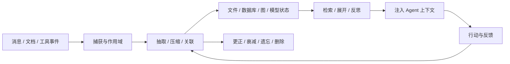

# awesome_agent_memory

**开源 AI Agent 记忆系统、文件记忆、图谱记忆、编码助手插件、研究实现与评测合集。**

Curated open-source memory systems, file-backed memory, temporal knowledge graphs, coding-agent integrations, procedural memory, and benchmarks for AI agents — with evidence-linked descriptions and reproducible GitHub maintenance rankings.

这里的“记忆”覆盖从交互捕获、事实/经历抽取、存储和作用域，到检索、反思、纠错、遗忘、删除与宿主注入的完整生命周期。普通向量数据库和只保留当前对话的短期缓存不单独收录。

[分类目录](#分类目录) · [项目详表](docs/projects.md) · [排序视图](docs/rankings.md) · [方法](docs/methodology.md) · [检索记录](docs/research.md) · [贡献](CONTRIBUTING.md)

分类描述的是项目主要职责，不表示功能互斥。首版追求可复核的生态地图，不声称穷尽全网项目。
