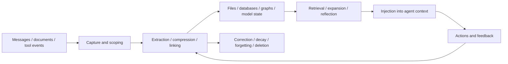

# awesome_agent_memory

**Curated open-source AI agent memory systems, file-backed memory, graph memory, coding-assistant plugins, research implementations and benchmarks — with evidence-linked descriptions and reproducible GitHub maintenance rankings.**

"Memory" here spans the full lifecycle: interaction capture, fact/experience extraction, storage and scoping, through retrieval, reflection, correction, forgetting, deletion and host injection. Plain vector databases and short-lived caches that only keep the current conversation are not catalogued on their own.

[Category index](#category-index) · [Project details](docs/projects.md) · [Rankings](docs/rankings.md) · [Methodology](docs/methodology.md) · [Research log](docs/research.md) · [Contributing](CONTRIBUTING.md)

Categories describe a project's primary responsibility, not mutually exclusive capabilities. The first release aims for a verifiable ecosystem map; it does not claim to cover every project on the internet.
