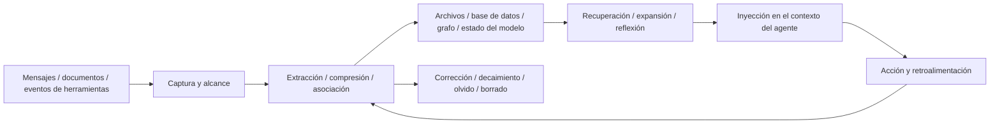

🌐 [English](../../README.md) · [简体中文](../zh/README.md) · **Español** · [हिन्दी](../hi/README.md) · [Français](../fr/README.md)

# awesome_agent_memory

**Catálogo de sistemas de memoria de código abierto para agentes de IA: memoria en archivos, memoria en grafos, complementos para asistentes de programación, implementaciones de investigación y benchmarks.**

Curación open source de sistemas de memoria para agentes de IA, memoria respaldada en archivos, grafos de conocimiento temporales, integraciones con agentes de programación, memoria procedimental y benchmarks — con descripciones enlazadas a evidencia y rankings de mantenimiento reproducibles en GitHub.

La "memoria" aquí cubre el ciclo completo: captura de interacciones, extracción de hechos y experiencias, almacenamiento y alcance, recuperación, reflexión, corrección, olvido, borrado e inyección en el hospedador. Las bases de datos vectoriales corrientes y las cachés de corto plazo que solo retienen la conversación actual no se incluyen por separado.

[Índice de categorías](#índice-de-categorías) · [Ficha detallada de proyectos](docs/projects.md) · [Vistas de ordenación](docs/rankings.md) · [Método](docs/methodology.md) · [Registro de búsqueda](docs/research.md) · [Contribuir](CONTRIBUTING.md)



Las categorías describen la responsabilidad principal de cada proyecto y no implican funciones mutuamente excluyentes. La primera versión aspira a un mapa del ecosistema verificable, no a agotar todos los proyectos existentes.

## Ir a una categoría

[Motores y servicios de memoria](#motores-y-servicios-de-memoria) · [Archivos como fuente de verdad y memoria auditable](#archivos-como-fuente-de-verdad-y-memoria-auditable) · [Grafos, entidades y memoria temporal](#grafos-entidades-y-memoria-temporal) · [Agentes de programación y memoria MCP](#agentes-de-programación-y-memoria-mcp) · [Experiencia, habilidades y memoria procedimental](#experiencia-habilidades-y-memoria-procedimental) · [Implementaciones de investigación y evaluación](#implementaciones-de-investigación-y-evaluación) · [Plataformas adyacentes, especificaciones e índices](#plataformas-adyacentes-especificaciones-e-índices) · [Histórico, archivado y licencias restringidas](#histórico-archivado-y-licencias-restringidas)

## Catálogo actual

**89 proyectos, de los cuales 54 provienen de los tres informes originales y 35 se han añadido en esta ronda.** Verificación funcional: 2026-11-20; instantánea de métricas: `2026-11-25T11:16:03+00:00` (UTC).

Dentro de cada categoría se estratifica primero por estado de mantenimiento y luego se ordena combinando estrellas (40%), commits en la rama por defecto a 90 días (35%) y último commit (25%). Los proyectos archivados van al final. La puntuación de mantenimiento solo describe popularidad y señales de actividad en GitHub; no representa la precisión de la memoria, el coste, la seguridad ni la madurez de producción.

## Vistazo rápido a los proyectos nucleares activos

Solo se muestran los candidatos principales con licencia abierta verificada y commits en los últimos 90 días; las implementaciones de investigación, los componentes de recuperación, las licencias restringidas y los proyectos históricos no entran en esta tabla.

| Proyecto | Propósito | Estrellas | Commits 90 d | Último commit UTC | Puntuación de mantenimiento |
| --- | --- | --- | --- | --- | --- |
| [claude-mem](https://github.com/thedotmack/claude-mem) | Captura sesiones y actividad de herramientas, los comprime en SQLite/FTS5/Chroma y los recupera en sesiones posteriores. | 119,652 | 2,482 | 2026-11-25 | 100.0 |
| [Hindsight](https://github.com/vectorize-io/hindsight) | Gestiona hechos estructurados, experiencias, entidades y observaciones sintéticas mediante retain, recall y reflect. | 63,300 | 1,619 | 2026-11-25 | 98.4 |
| [OpenViking](https://github.com/volcengine/OpenViking) | Gestiona de forma unificada recursos, memoria de largo plazo y Agent Skills mediante un sistema de archivos virtual navegable. | 42,746 | 1,456 | 2026-11-25 | 97.0 |
| [Cognee](https://github.com/topoteretes/cognee) | Convierte documentos, código y conversaciones en entidades, relaciones y grafos de conocimiento/memoria consultables. | 33,591 | 2,827 | 2026-11-20 | 94.8 |
| [Engram · Gentleman Programming](https://github.com/Gentleman-Programming/engram) | Memoria persistente en Go/SQLite/FTS5 para agentes de programación, con MCP, HTTP, CLI y TUI. | 8,306 | 941 | 2026-11-24 | 91.0 |
| [Graphiti](https://github.com/getzep/graphiti) | Extrae entidades y relaciones en tiempo real, construye un grafo de conocimiento bi-temporal y fusiona búsqueda léxica, vectorial y de grafo. | 33,081 | 162 | 2026-11-25 | 89.8 |
| [agentmemory · rohitg00](https://github.com/rohitg00/agentmemory) | Servicio y complementos de memoria para agentes de programación que fusionan BM25, vectores opcionales y relaciones estructuradas. | 30,584 | 233 | 2026-11-18 | 89.7 |
| [Basic Memory](https://github.com/basicmachines-co/basic-memory) | Usa notas Markdown editables y relaciones semánticas como memoria de conocimiento compartida entre personas y máquinas. | 4,707 | 837 | 2026-11-24 | 89.0 |
| [Honcho](https://github.com/plastic-labs/honcho) | Forma de manera continua representaciones de los pares y comprensión colaborativa en torno a peer, session y workspace. | 8,270 | 300 | 2026-11-24 | 88.3 |
| [Supermemory](https://github.com/supermemoryai/supermemory) | Plataforma de búsqueda híbrida y memoria para documentos, memorias y perfiles de usuario. | 31,708 | 130 | 2026-11-24 | 88.3 |
| [Mnemosyne · mnemosyne-oss](https://github.com/mnemosyne-oss/mnemosyne) | Capa de memoria multiframework basada en SQLite, local por defecto, con MCP e integraciones con varios agentes. | 3,703 | 927 | 2026-11-22 | 87.8 |
| [Mem0](https://github.com/mem0ai/mem0) | Capa de personalización universal que extrae, actualiza, borra y recupera memorias a partir de las interacciones. | 69,453 | 69 | 2026-11-25 | 87.7 |

## Índice de categorías

`★Referencia de los informes` indica que el proyecto proviene de los tres informes aportados por el usuario. Cada entrada tiene una sola categoría principal, para que un mismo repositorio no participe dos veces en la ordenación.

| Categoría | Cantidad | Proyectos mejor posicionados por mantenimiento |
| --- | --- | --- |
| Motores y servicios de memoria | 27 | Hindsight, OpenViking, agentmemory · rohitg00 |
| Archivos como fuente de verdad y memoria auditable | 11 | Engram · Gentleman Programming, Basic Memory, Mnemosyne · mnemosyne-oss |
| Grafos, entidades y memoria temporal | 7 | Cognee, Graphiti, CortexDB |
| Agentes de programación y memoria MCP | 10 | claude-mem, MCP Memory Service, dsh-mnemon |
| Experiencia, habilidades y memoria procedimental | 5 | memU, Mengram, LangMem |
| Implementaciones de investigación y evaluación | 19 | OWASP Agent Memory Guard, MemT-1.0, Agent Memory Benchmarks |
| Plataformas adyacentes, especificaciones e índices | 5 | QMD, Awesome Agent Memory · mnemoverse, Letta / MemGPT |
| Histórico, archivado y licencias restringidas | 5 | Engram App, Katra, Zep Legacy Community Edition |

### Motores y servicios de memoria

| Proyecto | Propósito | Estrellas | Commits 90 d | Último commit UTC | Puntuación de mantenimiento | Licencia |
| --- | --- | --- | --- | --- | --- | --- |
| [Hindsight](https://github.com/vectorize-io/hindsight) · ★Referencia de los informes | Gestiona hechos estructurados, experiencias, entidades y observaciones sintéticas mediante retain, recall y reflect. | 63,300 | 1,619 | 2026-11-25 | 98.4 | MIT |
| [OpenViking](https://github.com/volcengine/OpenViking) · ★Referencia de los informes | Gestiona de forma unificada recursos, memoria de largo plazo y Agent Skills mediante un sistema de archivos virtual navegable. | 42,746 | 1,456 | 2026-11-25 | 97.0 | AGPL-3.0 |
| [agentmemory · rohitg00](https://github.com/rohitg00/agentmemory) · ★Referencia de los informes | Servicio y complementos de memoria para agentes de programación que fusionan BM25, vectores opcionales y relaciones estructuradas. | 30,584 | 233 | 2026-11-18 | 89.7 | Apache-2.0 |
| [Honcho](https://github.com/plastic-labs/honcho) · ★Referencia de los informes | Forma de manera continua representaciones de los pares y comprensión colaborativa en torno a peer, session y workspace. | 8,270 | 300 | 2026-11-24 | 88.3 | AGPL-3.0 |
| [Supermemory](https://github.com/supermemoryai/supermemory) · ★Referencia de los informes | Plataforma de búsqueda híbrida y memoria para documentos, memorias y perfiles de usuario. | 31,708 | 130 | 2026-11-24 | 88.3 | MIT |
| [Mem0](https://github.com/mem0ai/mem0) · ★Referencia de los informes | Capa de personalización universal que extrae, actualiza, borra y recupera memorias a partir de las interacciones. | 69,453 | 69 | 2026-11-25 | 87.7 | Apache-2.0 |
| [Hy-Memory](https://github.com/Tencent-Hunyuan/Hy-Memory) | Motor de memoria cognitiva de doble sistema y SDK de Python para escenarios de conversación, agentes y programación. | 2,115 | 604 | 2026-11-18 | 84.8 | Apache-2.0 |
| [TencentDB Agent Memory](https://github.com/TencentCloud/TencentDB-Agent-Memory) | Centro de memoria para equipos que convierte conversaciones, documentos y código en Chat Memory, Skills, LLM-Wiki y Code-Graph. | 31,171 | 60 | 2026-11-24 | 83.8 | MIT |
| [MemOS](https://github.com/MemTensor/MemOS) · ★Referencia de los informes | Sistema operativo de memoria para agentes que cubre varios tipos de memoria, recuperación híbrida y evolución de habilidades. | 12,504 | 112 | 2026-11-09 | 80.3 | Apache-2.0 |
| [Remnic](https://github.com/joshuaswarren/remnic) | Capa de memoria consciente del usuario: alcance, procedencia, correcciones, fronteras, calidad de recuperación y MCP/HTTP. | 235 | 731 | 2026-11-24 | 78.6 | MIT |
| [Mnemon](https://github.com/mnemon-dev/mnemon) | Memoria persistente entre sesiones para agentes: organiza el conocimiento en estructura de grafo, con recuperación sensible a la intención e integración con varios hospedadores. | 744 | 121 | 2026-11-23 | 74.5 | Apache-2.0 |
| [MemMachine](https://github.com/MemMachine/MemMachine) · ★Referencia de los informes | Servicio de memoria de agentes universal con interfaces por usuario, proyecto y sesión. | 3,092 | 45 | 2026-11-23 | 74.0 | Apache-2.0 |
| [Membase](https://github.com/membaseai/membase) | Capa de memoria entre agentes con SDK, CLI y MCP, usable con cuenta gestionada o almacenamiento local. | 143 | 168 | 2026-11-25 | 71.1 | MIT |
| [openJiuwen Agent Memory](https://github.com/openJiuwen-ai/agent-memory) | Aporta a los agentes extracción, almacenamiento, recuperación y migración de memorias en múltiples formas. | 121 | 174 | 2026-11-25 | 70.8 | Apache-2.0 |
| [MIRIX](https://github.com/Mirix-AI/MIRIX) · ★Referencia de los informes | Sistema de memoria de largo plazo multitipo, multiagente y multimodal que sigue la actividad de trabajo y destila habilidades. | 3,517 | 23 | 2026-11-11 | 67.7 | Apache-2.0 |
| [LongMemory](https://github.com/CaviraOSS/LongMemory) · ★Referencia de los informes | Memoria de largo plazo local en TypeScript/SQLite con procedencia, tiempo, selección de evidencia y presupuesto de tokens. | 4,587 | 16 | 2026-11-10 | 66.3 | Apache-2.0 |
| [Agent Memory Lab](https://github.com/agent-memory-lab/agent-memory) · ★Referencia de los informes | Motor de memoria centrado en evidencia de origen, corrección de hechos, validez temporal y alcance. | 7 | 261 | 2026-11-14 | 60.7 | Apache-2.0 |
| [mem9](https://github.com/mem9-ai/mem9) · ★Referencia de los informes | Ofrece memoria entre agentes e ingesta de sesiones, con varios backends de almacenamiento en el servidor. | 1,236 | 15 | 2026-11-04 | 60.1 | Apache-2.0 |
| [Memori](https://github.com/MemoriLabs/Memori) · ★Referencia de los informes | Conecta la ingesta y la recuperación de memorias con las llamadas LLM existentes, en torno a la pertenencia de usuarios y procesos. | 17,605 | 2 | 2026-09-18 | 51.8 | Apache-2.0 |
| [Engram · TAIPANBOX](https://github.com/TAIPANBOX/engram) · ★Referencia de los informes | SQLite que aloja memoria episódica, semántica y procedimental, hechos bi-temporales, decaimiento y MCP. | 5 | 37 | 2026-11-23 | 51.3 | Apache-2.0 |
| [Agent MemoryForge](https://github.com/hellangleZ/Agent-MemoryForge) | Capa de memoria persistente, recuperable y auditable para agentes multiinquilino, con SDK y gateway. | 178 | 3 | 2026-09-29 | 39.0 | MIT |
| [Memvid](https://github.com/memvid/memvid) · ★Referencia de los informes | Archivo único portable con núcleo Rust que ofrece recuperación híbrida y SDK multilenguaje. | 17,437 | 0 | 2026-07-14 | 39.6 | Apache-2.0 |
| [Memobase](https://github.com/memodb-io/memobase) · ★Referencia de los informes | Mantiene la memoria de usuario de largo plazo en torno a perfiles y eventos temporales. | 2,966 | 0 | 2026-01-11 | 28.5 | Apache-2.0 |
| [Engram · HBarefoot](https://github.com/HBarefoot/engram) · ★Referencia de los informes | Librería de memoria en proceso (TypeScript/SQLite) con embeddings locales, MCP y una Skill de uso. | 9 | 0 | 2026-07-07 | 13.2 | MIT |
| [agent-memory · ivanzwb](https://github.com/ivanzwb/agent-memory) · ★Referencia de los informes | Librería de memoria embebida en TypeScript con memoria de trabajo, de sesión, de largo plazo y base de conocimiento. | 4 | 0 | 2026-04-13 | 7.6 | MIT |
| [MEMANTO](https://github.com/Jahvis/memanto-ai-memory) · ★Referencia de los informes | Servicio de memoria con versionado y metadatos de origen, envuelto en las primitivas remember, recall y answer. | 1 | 0 | 2026-06-05 | 6.1 | MIT |
| [OpenMemory · tawanorg](https://github.com/tawanorg/OpenMemory) | Servicio autoalojado de memoria semántica y de contexto de largo plazo, independiente del framework. | 1 | 0 | 2025-10-26 | 2.7 | MIT |

### Archivos como fuente de verdad y memoria auditable

| Proyecto | Propósito | Estrellas | Commits 90 d | Último commit UTC | Puntuación de mantenimiento | Licencia |
| --- | --- | --- | --- | --- | --- | --- |
| [Engram · Gentleman Programming](https://github.com/Gentleman-Programming/engram) | Memoria persistente en Go/SQLite/FTS5 para agentes de programación, con MCP, HTTP, CLI y TUI. | 8,306 | 941 | 2026-11-24 | 91.0 | MIT |
| [Basic Memory](https://github.com/basicmachines-co/basic-memory) · ★Referencia de los informes | Usa notas Markdown editables y relaciones semánticas como memoria de conocimiento compartida entre personas y máquinas. | 4,707 | 837 | 2026-11-24 | 89.0 | AGPL-3.0 |
| [Mnemosyne · mnemosyne-oss](https://github.com/mnemosyne-oss/mnemosyne) | Capa de memoria multiframework basada en SQLite, local por defecto, con MCP e integraciones con varios agentes. | 3,703 | 927 | 2026-11-22 | 87.8 | MIT |
| [EverOS](https://github.com/EverMind-AI/EverOS) · ★Referencia de los informes | Gestiona episodios/perfiles de usuario y casos/habilidades de agentes con Markdown como fuente de verdad e índice local. | 13,999 | 121 | 2026-11-25 | 85.2 | Apache-2.0 |
| [agent-memory · tigerless](https://github.com/tigerless-labs/agent-memory) · ★Referencia de los informes | Markdown como fuente de verdad, SQLite como índice reconstruible y una capa independiente de consolidación en reposo. | 4,320 | 381 | 2026-11-12 | 84.2 | MIT |
| [ReMe](https://github.com/agentscope-ai/ReMe) · ★Referencia de los informes | Organiza hechos y experiencias con Markdown, frontmatter y wikilinks; búsqueda léxica, vectorial y expansión relacional. | 3,840 | 187 | 2026-11-25 | 83.1 | Apache-2.0 |
| [MemSearch](https://github.com/zilliztech/memsearch) · ★Referencia de los informes | Markdown como fuente de verdad con índice derivado en Milvus: vectorial/BM25/RRF y expansión progresiva. | 2,936 | 70 | 2026-11-25 | 76.7 | MIT |
| [Sibyl Memory](https://github.com/Sibyl-Labs/Sibyl-Memory) | Familia de memoria de largo plazo en archivo único, sin base vectorial, con adaptadores SDK, CLI, MCP, Hermes y LangGraph. | 191 | 40 | 2026-11-19 | 62.7 | MIT |
| [Agent Memory Vault](https://github.com/mcncarl/agent-memory-vault) | Depósito de memoria compartida Markdown-first para Claude Code/Codex con Git, índices y auditoría. | 350 | 4 | 2026-10-04 | 43.5 | MIT |
| [Engram · shiblon](https://github.com/shiblon/engram) · ★Referencia de los informes | Un binario único con SQLite gestiona memoria de corto y largo plazo, preferencias y personalidad. | 19 | 24 | 2026-10-06 | 42.8 | Apache-2.0 |
| [Engram · B12Labs](https://github.com/B12Labs/engram) · ★Referencia de los informes | Formato portátil de memoria en un solo archivo con compresión de grafos y búsqueda rápida/híbrida/profunda. | 1 | 0 | 2026-04-15 | 4.5 | MIT |

### Grafos, entidades y memoria temporal

| Proyecto | Propósito | Estrellas | Commits 90 d | Último commit UTC | Puntuación de mantenimiento | Licencia |
| --- | --- | --- | --- | --- | --- | --- |
| [Cognee](https://github.com/topoteretes/cognee) · ★Referencia de los informes | Convierte documentos, código y conversaciones en entidades, relaciones y grafos de conocimiento/memoria consultables. | 33,591 | 2,827 | 2026-11-20 | 94.8 | Apache-2.0 |
| [Graphiti](https://github.com/getzep/graphiti) · ★Referencia de los informes | Extrae entidades y relaciones en tiempo real, construye un grafo de conocimiento bi-temporal y fusiona búsqueda léxica, vectorial y de grafo. | 33,081 | 162 | 2026-11-25 | 89.8 | Apache-2.0 |
| [CortexDB](https://github.com/liliang-cn/cortexdb) | Combina grafo de conocimiento, restricciones y razonamiento trazable dentro de un único archivo SQLite. | 531 | 602 | 2026-11-25 | 81.7 | MIT |
| [Neo4j Agent Memory](https://github.com/neo4j-labs/agent-memory) | Memoria de agente basada en grafos y context graph: almacena conversaciones, entidades, relaciones y trayectorias de razonamiento. | 616 | 201 | 2026-10-27 | 70.3 | Apache-2.0 |
| [Memoir](https://github.com/zhangfengcdt/memoir) | Memoria de agente jerárquica con control de versiones estilo Git. | 644 | 33 | 2026-10-27 | 60.4 | Apache-2.0 |
| [Lemmalog](https://github.com/JordyZomer/lemmalog) | Construye la memoria del agente con reglas Datalog, hechos de origen y derivación incremental. | 352 | 39 | 2026-10-01 | 54.7 | MIT |
| [Memory Graph](https://github.com/memory-graph/memory-graph) | Servicio MCP de memoria con seguimiento de relaciones y consultas de grafo para agentes de programación. | 258 | 9 | 2026-09-16 | 43.8 | MIT |

### Agentes de programación y memoria MCP

| Proyecto | Propósito | Estrellas | Commits 90 d | Último commit UTC | Puntuación de mantenimiento | Licencia |
| --- | --- | --- | --- | --- | --- | --- |
| [claude-mem](https://github.com/thedotmack/claude-mem) · ★Referencia de los informes | Captura sesiones y actividad de herramientas, los comprime en SQLite/FTS5/Chroma y los recupera en sesiones posteriores. | 119,652 | 2,482 | 2026-11-25 | 100.0 | Apache-2.0 |
| [MCP Memory Service](https://github.com/doobidoo/mcp-memory-service) · ★Referencia de los informes | Ofrece memoria semántica, relaciones y consolidación en segundo plano vía MCP/REST, con varios backends de almacenamiento. | 2,154 | 756 | 2026-11-25 | 86.6 | Apache-2.0 |
| [dsh-mnemon](https://github.com/omdsh-dev/dsh-mnemon) | Complemento de memoria jerárquica para DeepSeek Harness que combina memoria en tiempo de ejecución, documentación del proyecto y backends de memoria de largo plazo intercambiables. | 1,127 | 1,686 | 2026-11-24 | 84.2 | MIT |
| [OKF Agent Memory](https://github.com/okf-memory/okf-agent-memory) | Memoria Git-native para agentes de programación con MCP embebido y lectura progresiva. | 872 | 247 | 2026-11-21 | 78.5 | MIT |
| [Memorix](https://github.com/AVIDS2/memorix) | Memoria compartida entre hospedadores para varios agentes de programación a través de MCP. | 948 | 171 | 2026-11-19 | 76.2 | Apache-2.0 |
| [projectmem](https://github.com/riponcm/projectmem) · ★Referencia de los informes | Registra issues, intentos, arreglos y decisiones como log de eventos para que los agentes de programación no repitan fracasos. | 886 | 123 | 2026-11-20 | 74.5 | MIT |
| [Mnemoverse Memory Server](https://github.com/mnemoverse/mcp-memory-server) | Memoria persistente gestionada vía MCP con re-ranking por retroalimentación y salas compartidas entre agentes. | 30 | 142 | 2026-11-18 | 63.1 | MIT |
| [Codex Honcho](https://github.com/plastic-labs/codex-honcho) · ★Referencia de los informes | Integración oficial que conecta sesiones de Codex, actividad de herramientas e inyección de contexto con Honcho. | 66 | 1 | 2026-09-01 | 28.3 | MIT |
| [MegaMemory](https://github.com/0xK3vin/MegaMemory) | Grafo de conocimiento de proyecto persistente, búsqueda semántica y servicio MCP para agentes de programación. | 739 | 0 | 2026-05-03 | 25.5 | MIT |
| [mcp-mem0](https://github.com/coleam00/mcp-mem0) | Envuelve la memoria de largo plazo de Mem0 como servicio MCP para clientes de agentes. | 686 | 0 | 2025-04-13 | 22.7 | MIT |

### Experiencia, habilidades y memoria procedimental

| Proyecto | Propósito | Estrellas | Commits 90 d | Último commit UTC | Puntuación de mantenimiento | Licencia |
| --- | --- | --- | --- | --- | --- | --- |
| [memU](https://github.com/NevaMind-AI/memU) · ★Referencia de los informes | Memoria personal entre agentes y puente con hospedadores: los agentes destilan Markdown y Skills de memoria. | 14,639 | 61 | 2026-11-24 | 81.2 | Apache-2.0 |
| [Mengram](https://github.com/alibaizhanov/mengram) · ★Referencia de los informes | Organiza memoria semántica, episódica y procedimental, y mejora los flujos de trabajo con retroalimentación de los fallos. | 207 | 88 | 2026-11-09 | 64.8 | Apache-2.0 |
| [LangMem](https://github.com/langchain-ai/langmem) · ★Referencia de los informes | Extrae hechos de largo plazo de las conversaciones, busca memorias y optimiza el comportamiento del agente a partir de sus experiencias. | 1,793 | 13 | 2026-11-16 | 63.5 | MIT |
| [Engram · vincents-ai](https://github.com/vincents-ai/engram) · ★Referencia de los informes · Aviso de licencia | Contexto de proyecto distribuido, tareas, razonamiento y conocimiento de equipo para sistemas multiagente. | 25 | 9 | 2026-11-17 | 47.2 | AGPL-3.0-or-later o licencia comercial |
| [Acontext](https://github.com/memodb-io/Acontext) · ★Referencia de los informes · Archivado/histórico | Destila de ejecuciones y artefactos de agentes experiencias operativas y Skills legibles y editables. | 3,697 | 2 | 2026-10-24 | 52.3 | Apache-2.0 |

### Implementaciones de investigación y evaluación

| Proyecto | Propósito | Estrellas | Commits 90 d | Último commit UTC | Puntuación de mantenimiento | Licencia |
| --- | --- | --- | --- | --- | --- | --- |
| [OWASP Agent Memory Guard](https://github.com/OWASP/www-project-agent-memory-guard) | Protección en tiempo de ejecución e implementación de referencia contra la contaminación de memoria y contexto de agentes. | 212 | 245 | 2026-11-25 | 74.5 | Apache-2.0 |
| [MemT-1.0](https://github.com/MemTensor/MemT-1.0) · Aviso de licencia | Familia de modelos de memoria que explora lectura/escritura nativa de memoria en el modelo y Mixture-of-Storage. | 603 | 7 | 2026-11-20 | 57.6 | PolyForm Noncommercial-1.0.0 |
| [Agent Memory Benchmarks](https://github.com/RonsenbergVI/agent-memory-benchmarks) | Ofrece evaluación abierta e implementaciones de referencia para sistemas de memoria de agentes como LongMemEval o LoCoMo. | 2 | 210 | 2026-11-09 | 55.0 | MIT |
| [MemForest · Concyclics](https://github.com/Concyclics/MemForest) · ★Referencia de los informes | Organiza la memoria de largo plazo con un índice temporal jerárquico y ofrece una interfaz experimental en Python. | 37 | 25 | 2026-11-11 | 52.5 | MIT |
| [Agent Memory Leaderboard](https://github.com/AML-memory/agent-memory-leaderboard) · Aviso de licencia | Recopila resultados de evaluaciones y material comparativo de sistemas de memoria para agentes. | 1,241 | 2 | 2026-11-02 | 50.3 | Pendiente de verificación |
| [MemSkill](https://github.com/ViktorAxelsen/MemSkill) | Modela operaciones de memoria —extracción, consolidación, poda— como Skills aprendibles y evolutivas. | 610 | 3 | 2026-10-01 | 43.7 | Apache-2.0 |
| [MemoryAgentBench](https://github.com/HUST-AI-HYZ/MemoryAgentBench) · ★Referencia de los informes | Evalúa la construcción y el uso de la memoria de los agentes mediante interacción multiturno incremental. | 491 | 3 | 2026-09-25 | 42.0 | MIT |
| [T-Mem](https://github.com/Sherlockwz/T-Mem) · ★Referencia de los informes | Genera al escribir pistas de activación para consultas futuras y combina índices de hechos y escenarios para estudiar la recuperación asociativa. | 199 | 3 | 2026-09-09 | 36.8 | MIT |
| [MemForest · EventTree](https://github.com/Celina-love-sweet/MemForest) · ★Referencia de los informes | Segmenta mediante EventTree y fusiona y comprime de forma progresiva la memoria de largo plazo. | 63 | 4 | 2026-09-17 | 35.1 | MIT |
| [MemoryStackBench](https://github.com/aetna000/MemoryStackBench) | Evaluación automatizada de seguridad, evidencia, integridad del borrado y auditabilidad de la memoria de agentes. | 6 | 6 | 2026-09-11 | 28.6 | Apache-2.0 |
| [Agent Memory Radar](https://github.com/H20Zhang/Agent-Memory-Radar) · Aviso de licencia | Radar de investigación que compila mecanismos de memoria, benchmarks, contaminación, olvido y evidencia de recuperación. | 3 | 7 | 2026-09-11 | 27.3 | CC-BY-4.0 contenido / MIT código |
| [SimpleMem](https://github.com/aiming-lab/SimpleMem) · ★Referencia de los informes | Investiga la compresión con estructura semántica, la consolidación de memorias y la recuperación adaptativa. | 3,881 | 0 | 2026-07-24 | 35.0 | MIT |
| [MemoryOS](https://github.com/BAI-LAB/MemoryOS) · ★Referencia de los informes | Investiga la memoria jerárquica de corto, medio y largo plazo, su actualización y la gestión de perfiles de usuario. | 1,627 | 0 | 2026-07-07 | 30.9 | Apache-2.0 |
| [A-MEM](https://github.com/agiresearch/A-mem) · ★Referencia de los informes | Toma prestado Zettelkasten para organizar, enlazar y evolucionar notas de memoria de forma automática. | 1,218 | 0 | 2025-12-12 | 25.2 | MIT |
| [agentmemory · JordanMcCann](https://github.com/JordanMcCann/agentmemory) · ★Referencia de los informes | Estudia la recuperación multiseñal: semántica, léxica, grafo, importancia y tiempo. | 46 | 0 | 2026-03-26 | 15.1 | MIT |
| [MPBench](https://github.com/Digital-Trust-Lab/mp-bench) | Dataset de ataques de contaminación de memoria que evalúa escritura persistente, recuperación posterior y activación conductual. | 7 | 0 | 2026-06-28 | 12.0 | Apache-2.0 |
| [agent-memory-bench](https://github.com/thomasfevre/agent-memory-bench) · Aviso de licencia | Evaluación de memoria auditable centrada en aciertos de evidencia, respuestas y comportamiento de recuperación. | 0 | 0 | 2026-07-30 | 6.8 | Pendiente de verificación |
| [MemEngine](https://github.com/nuster1128/MemEngine) · ★Referencia de los informes · Aviso de licencia | Librería modular de investigación sobre memoria de agentes que cubre varios tipos de módulos de memoria y evaluación. | 117 | 0 | 2025-05-13 | 16.6 | Pendiente de verificación |
| [MemoryBank / SiliconFriend](https://github.com/zhongwanjun/MemoryBank-SiliconFriend) · ★Referencia de los informes · Archivado/histórico | Implementación de investigación temprana sobre interacción prolongada, perfil de usuario, consolidación y olvido de memorias. | 456 | 0 | 2023-05-24 | 21.3 | MIT |

### Plataformas adyacentes, especificaciones e índices

| Proyecto | Propósito | Estrellas | Commits 90 d | Último commit UTC | Puntuación de mantenimiento | Licencia |
| --- | --- | --- | --- | --- | --- | --- |
| [QMD](https://github.com/tobi/qmd) · ★Referencia de los informes | BM25, vectores, expansión de consultas, rerank y MCP para Markdown y documentos locales. | 31,587 | 131 | 2026-11-20 | 87.2 | MIT |
| [Awesome Agent Memory · mnemoverse](https://github.com/mnemoverse/awesome-agent-memory) | Índice externo de sistemas, frameworks, benchmarks e investigación sobre memoria de agentes. | 68 | 87 | 2026-11-23 | 64.4 | CC0-1.0 |
| [Letta / MemGPT](https://github.com/letta-ai/letta) · ★Referencia de los informes | Plataforma completa de agentes centrada en el estado persistente y la autogestión del contexto por el propio agente. | 25,540 | 4 | 2026-10-18 | 60.8 | Apache-2.0 |
| [MineContext](https://github.com/volcengine/MineContext) · ★Referencia de los informes | Genera actividades, resúmenes y material consultable a partir de contexto digital como la pantalla. | 5,556 | 0 | 2026-05-07 | 32.6 | Apache-2.0 |
| [MCP Memory Server](https://github.com/modelcontextprotocol/servers) · ★Referencia de los informes · Archivado/histórico · Aviso de licencia | Componentes de memoria entities, relations y observations del repositorio padre oficial de MCP servers. | 92,238 | 1,119 | 2026-11-18 | 97.8 | Transición Apache-2.0 / MIT; documentación CC-BY-4.0 |

### Histórico, archivado y licencias restringidas

| Proyecto | Propósito | Estrellas | Commits 90 d | Último commit UTC | Puntuación de mantenimiento | Licencia |
| --- | --- | --- | --- | --- | --- | --- |
| [Engram App](https://github.com/engram-app/Engram) · ★Referencia de los informes · Aviso de licencia | Proyecto source-visible con memoria cognitiva e integración de agentes. | 2 | 743 | 2026-11-25 | 63.8 | PolyForm Small Business-1.0.0 / licencia comercial |
| [Katra](https://github.com/kolegadev/Katra-Agentic-Memory) · Aviso de licencia | Dispositivo MCP de memoria cognitiva con episodios, semántica, grafos y consolidación en reposo. | 9 | 119 | 2026-10-29 | 53.5 | BSL-1.1 |
| [Zep Legacy Community Edition](https://github.com/getzep/zep) · ★Referencia de los informes · Archivado/histórico | La antigua Community Edition de Zep y ejemplos de integración con el producto cloud actual. | 5,013 | 27 | 2026-11-17 | 71.3 | Apache-2.0 |
| [Engram · Agentscreator](https://github.com/Agentscreator/engram-memory) · ★Referencia de los informes · Archivado/histórico | Proyecto archivado sobre memoria compartida multiagente, conflictos y coherencia. | 82 | 0 | 2026-05-23 | 18.5 | Apache-2.0 |
| [EverMemOS_bz](https://github.com/beizhangnina/EverMemOS_bz) · Archivado/histórico | Fork de EverMemOS que conserva la implementación anterior centrada en extracción conversacional, memoria estructurada y recuperación multiestrategia. | 1 | 0 | 2025-11-28 | 2.9 | Apache-2.0 |

## Cómo elegir

- Si necesitas una API completa de memoria externa: empieza por los motores y servicios de memoria.
- Si necesitas memoria auditable, editable y gestionable con Git: mira los archivos como fuente de verdad.
- Si necesitas relaciones entre entidades, validez temporal y saltos múltiples: mira los grafos y la memoria temporal.
- Si necesitas memoria entre hospedadores como Claude Code, Codex u OpenCode: mira agentes de programación/MCP.
- Si necesitas convertir aciertos y fracasos en métodos ejecutables: mira experiencia, habilidades y memoria procedimental.
- Si necesitas verificar eficacia, contaminación, borrado y olvido: mira implementaciones de investigación y evaluación.

Las fronteras completas y la evidencia están en [Ficha detallada de proyectos](docs/projects.md), y los criterios de clasificación en [Alcance y categorías](docs/taxonomy.md).

## Datos y mantenimiento

- [Ordenaciones combinada, por estrellas, por actividad y por último commit](docs/rankings.md)
- [Método de ordenación y limitaciones](docs/methodology.md)
- [Palabras clave de búsqueda, fuentes y cobertura](docs/research.md)
- [Proyecto JSON](../../data/projects.json) · [Métricas JSON](../../data/metrics.json) · [CSV de ordenación](../../data/rankings.csv)
- [Guía de contribución](CONTRIBUTING.md)

```sh
python scripts/refresh_metrics.py
python scripts/build.py
python -m unittest discover -s tests -v
python scripts/build.py --check
```

GitHub Actions refresca a diario las métricas de GitHub. El alta de proyectos y los juicios de funciones, categorías y licencia exigen verificación manual.

## Licencias y agradecimientos

La compilación original y los scripts de este catálogo están bajo [MIT](../../LICENSE); los proyectos enlazados siguen sus propias licencias. Los casos desconocidos, compuestos, no comerciales o BSL/PolyForm conservan sus fronteras originales.

La clasificación inicial y el mapa de proyectos provienen de los tres informes locales aportados por el usuario; en esta ronda se usó además [mnemoverse/awesome-agent-memory](https://github.com/mnemoverse/awesome-agent-memory) como contraste de cobertura, y cada entrada se verificó después en el repositorio oficial correspondiente.

El [registro de cambios](../../record/) conserva el texto original tal como se redactó en el momento de cada verificación (en chino), para poder auditar el origen y la formulación de cada juicio.
