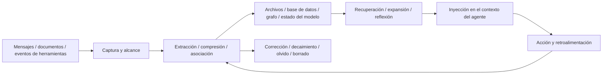

# awesome_agent_memory

**Catálogo de sistemas de memoria de código abierto para agentes de IA: memoria en archivos, memoria en grafos, complementos para asistentes de programación, implementaciones de investigación y benchmarks.**

Curación open source de sistemas de memoria para agentes de IA, memoria respaldada en archivos, grafos de conocimiento temporales, integraciones con agentes de programación, memoria procedimental y benchmarks — con descripciones enlazadas a evidencia y rankings de mantenimiento reproducibles en GitHub.

La "memoria" aquí cubre el ciclo completo: captura de interacciones, extracción de hechos y experiencias, almacenamiento y alcance, recuperación, reflexión, corrección, olvido, borrado e inyección en el hospedador. Las bases de datos vectoriales corrientes y las cachés de corto plazo que solo retienen la conversación actual no se incluyen por separado.

[Índice de categorías](#índice-de-categorías) · [Ficha detallada de proyectos](docs/projects.md) · [Vistas de ordenación](docs/rankings.md) · [Método](docs/methodology.md) · [Registro de búsqueda](docs/research.md) · [Contribuir](CONTRIBUTING.md)

Las categorías describen la responsabilidad principal de cada proyecto y no implican funciones mutuamente excluyentes. La primera versión aspira a un mapa del ecosistema verificable, no a agotar todos los proyectos existentes.
