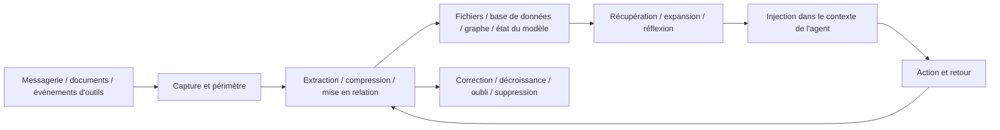

🌐 [English](../../README.md) · [简体中文](../zh/README.md) · [Español](../es/README.md) · [हिन्दी](../hi/README.md) · **Français**

# awesome_agent_memory

**Collection open source de systèmes de mémoire pour agents IA : mémoire fichier, mémoire en graphe, plugins d'assistants de codage, implémentations de recherche et benchmarks.**

Sélection curated de systèmes de mémoire open source, de mémoire à source fichier, de graphes de connaissances temporels, d'intégrations pour agents de codage, de mémoire procédurale et de benchmarks pour agents IA — avec des descriptions liées à des preuves et des classements de maintenance GitHub reproductibles.

La « mémoire » couverte ici suit tout le cycle de vie : capture des interactions, extraction des faits et des expériences, stockage et périmètre, puis récupération, réflexion, correction, oubli, suppression et injection dans l'hôte. Les bases vectoristes ordinaires et les caches court terme limités à la conversation en cours ne sont pas recensés séparément.

[Index par catégorie](#index-par-catégorie) · [Détail des projets](docs/projects.md) · [Vues de classement](docs/rankings.md) · [Méthode](docs/methodology.md) · [Journal de recherche](docs/research.md) · [Contribuer](CONTRIBUTING.md)



Les catégories décrivent la responsabilité principale du projet, pas une exclusivité fonctionnelle. La première version vise une carte vérifiable de l'écosystème ; elle ne prétend pas recenser tous les projets du web.

## Aller à une catégorie

[Moteurs et services de mémoire](#moteurs-et-services-de-mémoire) · [Source fichier et mémoire consultable](#source-fichier-et-mémoire-consultable) · [Graphes, entités et mémoire temporelle](#graphes-entités-et-mémoire-temporelle) · [Mémoire des agents de codage et MCP](#mémoire-des-agents-de-codage-et-mcp) · [Expérience, compétences et mémoire procédurale](#expérience-compétences-et-mémoire-procédurale) · [Implémentations de recherche et évaluation](#implémentations-de-recherche-et-évaluation) · [Plateformes, spécifications et index adjacents](#plateformes-spécifications-et-index-adjacents) · [Historique, archivés et licences restreintes](#historique-archivés-et-licences-restreintes)

## Sélection actuelle

**89 projets, dont 54 issus des trois études initiales et 35 ajoutés lors de cette passe.** Vérification fonctionnelle : 2026-11-20 ; instantané des métriques : `2026-11-25T11:05:14+00:00` (UTC).

Dans chaque catégorie, les projets sont d'abord stratifiés par état de maintenance, puis classés par une combinaison d'étoiles (40 %), de commits sur la branche par défaut à 90 jours (35 %) et de récence du dernier commit (25 %). Les projets archivés sont relégués en fin de liste. Le score de maintenance ne décrit que la visibilité et les signes d'activité sur GitHub ; il ne représente ni la précision de rappel mémoire, ni le coût, ni la sécurité, ni la maturité de production.

## Aperçu des projets principaux actifs

N'affiche que les candidats principaux, à licence ouverte vérifiée, avec un commit sur les 90 derniers jours ; les implémentations de recherche, les composants de récupération, les licences restreintes et les projets historiques n'entrent pas dans ce tableau.

| Projet | Positionnement | Étoiles | Commits 90 j | Dernier commit UTC | Score de maintenance |
| --- | --- | --- | --- | --- | --- |
| [claude-mem](https://github.com/thedotmack/claude-mem) | Capture sessions et activité des outils, les compresse dans SQLite/FTS5/Chroma et les rappelle dans les sessions suivantes. | 119,651 | 2,482 | 2026-11-25 | 100.0 |
| [Hindsight](https://github.com/vectorize-io/hindsight) | Gère faits structurés, expériences, entités et observations synthétiques via retain, recall et reflect. | 63,299 | 1,618 | 2026-11-25 | 98.4 |
| [OpenViking](https://github.com/volcengine/OpenViking) | Gère ressources, mémoire long terme et Agent Skills dans un système de fichiers virtuel navigable, de façon unifiée. | 42,746 | 1,456 | 2026-11-25 | 97.0 |
| [Cognee](https://github.com/topoteretes/cognee) | Convertit documents, code et conversations en relations d'entités et en graphes de connaissances/mémoire interrogeables. | 33,591 | 2,828 | 2026-11-20 | 94.8 |
| [Engram · Gentleman Programming](https://github.com/Gentleman-Programming/engram) | Mémoire persistante Go/SQLite/FTS5 pour agents de codage avec MCP, HTTP, CLI et TUI. | 8,305 | 941 | 2026-11-24 | 91.0 |
| [Graphiti](https://github.com/getzep/graphiti) | Extrait entités et relations en temps réel, construit un graphe de connaissances bi-temporel et fusionne récupération lexicale, vectorielle et par graphe. | 33,081 | 162 | 2026-11-25 | 89.8 |
| [agentmemory · rohitg00](https://github.com/rohitg00/agentmemory) | Service et plugin pour agents de codage combinant BM25, vecteurs optionnels et relations structurelles. | 30,584 | 233 | 2026-11-18 | 89.7 |
| [Basic Memory](https://github.com/basicmachines-co/basic-memory) | Notes Markdown éditables et relations sémantiques comme mémoire de connaissances partagée entre humains et machines. | 4,707 | 837 | 2026-11-24 | 89.0 |
| [Honcho](https://github.com/plastic-labs/honcho) | Forme en continu des représentations des pairs et une compréhension collaborative autour des peers, sessions et workspaces. | 8,270 | 300 | 2026-11-24 | 88.3 |
| [Supermemory](https://github.com/supermemoryai/supermemory) | Plateforme de recherche hybride et de mémoire pour documents, souvenirs et profils utilisateurs. | 31,707 | 130 | 2026-11-24 | 88.3 |
| [Mnemosyne · mnemosyne-oss](https://github.com/mnemosyne-oss/mnemosyne) | Couche de mémoire inter-frameworks pilotée par SQLite, locale par défaut, avec MCP et plusieurs intégrations d'agents. | 3,703 | 927 | 2026-11-22 | 87.8 |
| [Mem0](https://github.com/mem0ai/mem0) | Couche de mémoire de personnalisation générale : extraction, mise à jour, suppression et récupération des mémoires à partir des interactions. | 69,452 | 69 | 2026-11-25 | 87.7 |

## Index par catégorie

`★référence des rapports` signale un projet issu des trois études fournies par l'utilisateur. Chaque dépôt n'a qu'une seule catégorie principale, pour éviter qu'un même dépôt participe deux fois au classement.

| Catégorie | Nombre | Projets les mieux classés en maintenance |
| --- | --- | --- |
| Moteurs et services de mémoire | 27 | Hindsight, OpenViking, agentmemory · rohitg00 |
| Source fichier et mémoire consultable | 11 | Engram · Gentleman Programming, Basic Memory, Mnemosyne · mnemosyne-oss |
| Graphes, entités et mémoire temporelle | 7 | Cognee, Graphiti, CortexDB |
| Mémoire des agents de codage et MCP | 10 | claude-mem, MCP Memory Service, dsh-mnemon |
| Expérience, compétences et mémoire procédurale | 5 | memU, Mengram, LangMem |
| Implémentations de recherche et évaluation | 19 | OWASP Agent Memory Guard, MemT-1.0, Agent Memory Benchmarks |
| Plateformes, spécifications et index adjacents | 5 | QMD, Awesome Agent Memory · mnemoverse, Letta / MemGPT |
| Historique, archivés et licences restreintes | 5 | Engram App, Katra, Zep Legacy Community Edition |

### Moteurs et services de mémoire

| Projet | Positionnement | Étoiles | Commits 90 j | Dernier commit UTC | Score de maintenance | Licence |
| --- | --- | --- | --- | --- | --- | --- |
| [Hindsight](https://github.com/vectorize-io/hindsight) · ★référence des rapports | Gère faits structurés, expériences, entités et observations synthétiques via retain, recall et reflect. | 63,299 | 1,618 | 2026-11-25 | 98.4 | MIT |
| [OpenViking](https://github.com/volcengine/OpenViking) · ★référence des rapports | Gère ressources, mémoire long terme et Agent Skills dans un système de fichiers virtuel navigable, de façon unifiée. | 42,746 | 1,456 | 2026-11-25 | 97.0 | AGPL-3.0 |
| [agentmemory · rohitg00](https://github.com/rohitg00/agentmemory) · ★référence des rapports | Service et plugin pour agents de codage combinant BM25, vecteurs optionnels et relations structurelles. | 30,584 | 233 | 2026-11-18 | 89.7 | Apache-2.0 |
| [Honcho](https://github.com/plastic-labs/honcho) · ★référence des rapports | Forme en continu des représentations des pairs et une compréhension collaborative autour des peers, sessions et workspaces. | 8,270 | 300 | 2026-11-24 | 88.3 | AGPL-3.0 |
| [Supermemory](https://github.com/supermemoryai/supermemory) · ★référence des rapports | Plateforme de recherche hybride et de mémoire pour documents, souvenirs et profils utilisateurs. | 31,707 | 130 | 2026-11-24 | 88.3 | MIT |
| [Mem0](https://github.com/mem0ai/mem0) · ★référence des rapports | Couche de mémoire de personnalisation générale : extraction, mise à jour, suppression et récupération des mémoires à partir des interactions. | 69,452 | 69 | 2026-11-25 | 87.7 | Apache-2.0 |
| [Hy-Memory](https://github.com/Tencent-Hunyuan/Hy-Memory) | Moteur de mémoire cognitive à deux systèmes et SDK Python pour la conversation, les agents et le codage. | 2,115 | 604 | 2026-11-18 | 84.8 | Apache-2.0 |
| [TencentDB Agent Memory](https://github.com/TencentCloud/TencentDB-Agent-Memory) | Centre de mémoire d'équipe transformant conversations, documents et code en Chat Memory, Skills, LLM-Wiki et Code-Graph. | 31,171 | 60 | 2026-11-24 | 83.8 | MIT |
| [MemOS](https://github.com/MemTensor/MemOS) · ★référence des rapports | Système d'exploitation mémoire pour agents, couvrant plusieurs types de mémoire, récupération hybride et évolution des compétences. | 12,504 | 112 | 2026-11-09 | 80.3 | Apache-2.0 |
| [Remnic](https://github.com/joshuaswarren/remnic) | Couche de mémoire consciente de l'utilisateur, axée périmètre, source, correction, frontières, qualité de récupération et MCP/HTTP. | 235 | 731 | 2026-11-24 | 78.6 | MIT |
| [Mnemon](https://github.com/mnemon-dev/mnemon) | Mémoire persistante inter-sessions pour agents, organisant les connaissances en structure de graphe, avec récupération sensible à l'intention et connexions à plusieurs hôtes. | 744 | 121 | 2026-11-23 | 74.5 | Apache-2.0 |
| [MemMachine](https://github.com/MemMachine/MemMachine) · ★référence des rapports | Service de mémoire d'agent généraliste avec des interfaces par utilisateur, projet et session. | 3,092 | 45 | 2026-11-23 | 74.0 | Apache-2.0 |
| [Membase](https://github.com/membaseai/membase) | Couche de mémoire inter-agents avec SDK, CLI et MCP, sur compte managé ou stockage local. | 143 | 168 | 2026-11-25 | 71.1 | MIT |
| [openJiuwen Agent Memory](https://github.com/openJiuwen-ai/agent-memory) | Extraction, stockage, récupération, migration de mémoire et mémoires multi-formes pour agents. | 121 | 174 | 2026-11-25 | 70.8 | Apache-2.0 |
| [MIRIX](https://github.com/Mirix-AI/MIRIX) · ★référence des rapports | Système de mémoire long terme multi-types, multi-agents et multi-modal qui suit les activités de travail et distille des compétences. | 3,517 | 23 | 2026-11-11 | 67.7 | Apache-2.0 |
| [LongMemory](https://github.com/CaviraOSS/LongMemory) · ★référence des rapports | Mémoire long terme TypeScript/SQLite locale avec source, temporalité, sélection des preuves et budget de tokens. | 4,587 | 16 | 2026-11-10 | 66.3 | Apache-2.0 |
| [Agent Memory Lab](https://github.com/agent-memory-lab/agent-memory) · ★référence des rapports | Moteur de mémoire mettant l'accent sur les preuves sources, la correction des faits, la validité temporelle et le périmètre. | 7 | 261 | 2026-11-14 | 60.7 | Apache-2.0 |
| [mem9](https://github.com/mem9-ai/mem9) · ★référence des rapports | Mémoire inter-agents et ingestion de sessions, avec plusieurs backends de stockage côté serveur. | 1,236 | 15 | 2026-11-04 | 60.1 | Apache-2.0 |
| [Memori](https://github.com/MemoriLabs/Memori) · ★référence des rapports | Intègre l'ingestion et la récupération de mémoire dans les appels LLM existants, avec attribution aux utilisateurs et aux processus. | 17,605 | 2 | 2026-09-18 | 51.8 | Apache-2.0 |
| [Engram · TAIPANBOX](https://github.com/TAIPANBOX/engram) · ★référence des rapports | Mémoire épisodique, sémantique et procédurale sur SQLite, faits bi-temporels, décroissance et MCP. | 5 | 37 | 2026-11-23 | 51.3 | Apache-2.0 |
| [Agent MemoryForge](https://github.com/hellangleZ/Agent-MemoryForge) | Couche de mémoire persistante, récupérable et auditable pour agents multi-locataires, avec SDK et gateway. | 178 | 3 | 2026-09-29 | 39.0 | MIT |
| [Memvid](https://github.com/memvid/memvid) · ★référence des rapports | Récupération hybride et SDK multi-langages reposant sur un fichier portable unique et un noyau Rust. | 17,437 | 0 | 2026-07-14 | 39.6 | Apache-2.0 |
| [Memobase](https://github.com/memodb-io/memobase) · ★référence des rapports | Entretient la mémoire long terme des utilisateurs autour des profils et des événements temporels. | 2,966 | 0 | 2026-01-11 | 28.5 | Apache-2.0 |
| [Engram · HBarefoot](https://github.com/HBarefoot/engram) · ★référence des rapports | Bibliothèque de mémoire TypeScript/SQLite in-process avec embedding local, MCP et Skill d'usage. | 9 | 0 | 2026-07-07 | 13.2 | MIT |
| [agent-memory · ivanzwb](https://github.com/ivanzwb/agent-memory) · ★référence des rapports | Bibliothèque de mémoire embarquée TypeScript couvrant mémoire de travail, de session, long terme et base de connaissances. | 4 | 0 | 2026-04-13 | 7.6 | MIT |
| [MEMANTO](https://github.com/Jahvis/memanto-ai-memory) · ★référence des rapports | Service de mémoire avec métadonnées de version et de source, exposé via les primitives remember, recall et answer. | 1 | 0 | 2026-06-05 | 6.1 | MIT |
| [OpenMemory · tawanorg](https://github.com/tawanorg/OpenMemory) | Service auto-hébergé de mémoire sémantique et de contexte à long terme, indépendant du framework. | 1 | 0 | 2025-10-26 | 2.7 | MIT |

### Source fichier et mémoire consultable

| Projet | Positionnement | Étoiles | Commits 90 j | Dernier commit UTC | Score de maintenance | Licence |
| --- | --- | --- | --- | --- | --- | --- |
| [Engram · Gentleman Programming](https://github.com/Gentleman-Programming/engram) | Mémoire persistante Go/SQLite/FTS5 pour agents de codage avec MCP, HTTP, CLI et TUI. | 8,305 | 941 | 2026-11-24 | 91.0 | MIT |
| [Basic Memory](https://github.com/basicmachines-co/basic-memory) · ★référence des rapports | Notes Markdown éditables et relations sémantiques comme mémoire de connaissances partagée entre humains et machines. | 4,707 | 837 | 2026-11-24 | 89.0 | AGPL-3.0 |
| [Mnemosyne · mnemosyne-oss](https://github.com/mnemosyne-oss/mnemosyne) | Couche de mémoire inter-frameworks pilotée par SQLite, locale par défaut, avec MCP et plusieurs intégrations d'agents. | 3,703 | 927 | 2026-11-22 | 87.8 | MIT |
| [EverOS](https://github.com/EverMind-AI/EverOS) · ★référence des rapports | Gère épisodes/profils utilisateurs et cas/compétences d'agents via une source Markdown et un index local. | 13,999 | 121 | 2026-11-25 | 85.2 | Apache-2.0 |
| [agent-memory · tigerless](https://github.com/tigerless-labs/agent-memory) · ★référence des rapports | Markdown comme source de vérité, SQLite comme index reconstruisable, avec une couche autonome de consolidation au repos. | 4,320 | 381 | 2026-11-12 | 84.2 | MIT |
| [ReMe](https://github.com/agentscope-ai/ReMe) · ★référence des rapports | Organise faits et expériences en Markdown/frontmatter/wikilinks, avec extension lexicale, vectorielle et relationnelle. | 3,840 | 187 | 2026-11-25 | 83.1 | Apache-2.0 |
| [MemSearch](https://github.com/zilliztech/memsearch) · ★référence des rapports | Source Markdown avec index dérivé Milvus, récupération vectorielle/BM25/RRF et expansion progressive. | 2,936 | 70 | 2026-11-25 | 76.7 | MIT |
| [Sibyl Memory](https://github.com/Sibyl-Labs/Sibyl-Memory) | Famille de mémoire long terme en fichier unique sans base vectorielle : SDK, CLI, MCP, Hermes et adaptateur LangGraph. | 191 | 40 | 2026-11-19 | 62.7 | MIT |
| [Agent Memory Vault](https://github.com/mcncarl/agent-memory-vault) | Coffre de mémoire partagée Markdown-first pour Claude Code/Codex, avec Git, index et audit. | 350 | 4 | 2026-10-04 | 43.5 | MIT |
| [Engram · shiblon](https://github.com/shiblon/engram) · ★référence des rapports | Binaire unique et SQLite gérant mémoire court/long terme, préférences et persona. | 19 | 24 | 2026-10-06 | 42.8 | Apache-2.0 |
| [Engram · B12Labs](https://github.com/B12Labs/engram) · ★référence des rapports | Format de mémoire portable en fichier unique avec compression de graphe et recherches rapide/hybride/profonde. | 1 | 0 | 2026-04-15 | 4.5 | MIT |

### Graphes, entités et mémoire temporelle

| Projet | Positionnement | Étoiles | Commits 90 j | Dernier commit UTC | Score de maintenance | Licence |
| --- | --- | --- | --- | --- | --- | --- |
| [Cognee](https://github.com/topoteretes/cognee) · ★référence des rapports | Convertit documents, code et conversations en relations d'entités et en graphes de connaissances/mémoire interrogeables. | 33,591 | 2,828 | 2026-11-20 | 94.8 | Apache-2.0 |
| [Graphiti](https://github.com/getzep/graphiti) · ★référence des rapports | Extrait entités et relations en temps réel, construit un graphe de connaissances bi-temporel et fusionne récupération lexicale, vectorielle et par graphe. | 33,081 | 162 | 2026-11-25 | 89.8 | Apache-2.0 |
| [CortexDB](https://github.com/liliang-cn/cortexdb) | Combine graphe de connaissances, contraintes et raisonnement traçable dans un seul fichier SQLite. | 531 | 602 | 2026-11-25 | 81.7 | MIT |
| [Neo4j Agent Memory](https://github.com/neo4j-labs/agent-memory) | Mémoire d'agent et graphe de contexte basés sur Neo4j, stockant conversations, entités, relations et traces de raisonnement. | 616 | 201 | 2026-10-27 | 70.3 | Apache-2.0 |
| [Memoir](https://github.com/zhangfengcdt/memoir) | Mémoire d'agent hiérarchisée avec contrôle de version façon Git. | 644 | 33 | 2026-10-27 | 60.4 | Apache-2.0 |
| [Lemmalog](https://github.com/JordyZomer/lemmalog) | Construit la mémoire d'agent avec des règles Datalog, des faits sources et une dérivation incrémentale. | 352 | 39 | 2026-10-01 | 54.7 | MIT |
| [Memory Graph](https://github.com/memory-graph/memory-graph) | Service de mémoire MCP pour agents de codage, avec suivi de relations et requêtes de graphe. | 258 | 9 | 2026-09-16 | 43.8 | MIT |

### Mémoire des agents de codage et MCP

| Projet | Positionnement | Étoiles | Commits 90 j | Dernier commit UTC | Score de maintenance | Licence |
| --- | --- | --- | --- | --- | --- | --- |
| [claude-mem](https://github.com/thedotmack/claude-mem) · ★référence des rapports | Capture sessions et activité des outils, les compresse dans SQLite/FTS5/Chroma et les rappelle dans les sessions suivantes. | 119,651 | 2,482 | 2026-11-25 | 100.0 | Apache-2.0 |
| [MCP Memory Service](https://github.com/doobidoo/mcp-memory-service) · ★référence des rapports | Mémoire sémantique, relations et consolidation en arrière-plan via MCP/REST, avec plusieurs backends de stockage. | 2,154 | 756 | 2026-11-25 | 86.6 | Apache-2.0 |
| [dsh-mnemon](https://github.com/omdsh-dev/dsh-mnemon) | Plugin de mémoire hiérarchique pour DeepSeek Harness, combinant mémoire runtime, documentation projet et backends de mémoire long terme interchangeables. | 1,127 | 1,686 | 2026-11-24 | 84.2 | MIT |
| [OKF Agent Memory](https://github.com/okf-memory/okf-agent-memory) | Mémoire d'agent de codage Git-native avec MCP embarqué et lecture progressive. | 872 | 247 | 2026-11-21 | 78.5 | MIT |
| [Memorix](https://github.com/AVIDS2/memorix) | Mémoire partagée inter-hôtes via MCP pour plusieurs agents de codage. | 948 | 171 | 2026-11-19 | 76.2 | Apache-2.0 |
| [projectmem](https://github.com/riponcm/projectmem) · ★référence des rapports | Journalise problèmes, tentatives, correctifs et décisions en journal d'événements pour éviter aux agents de codage de répéter les échecs. | 886 | 123 | 2026-11-20 | 74.5 | MIT |
| [Mnemoverse Memory Server](https://github.com/mnemoverse/mcp-memory-server) | Mémoire persistante managée, rerank par retour utilisateur et salles partagées multi-agents via MCP. | 30 | 142 | 2026-11-18 | 63.1 | MIT |
| [Codex Honcho](https://github.com/plastic-labs/codex-honcho) · ★référence des rapports | Intégration officielle reliant sessions Codex, activité des outils et injection de contexte à Honcho. | 66 | 1 | 2026-09-01 | 28.3 | MIT |
| [MegaMemory](https://github.com/0xK3vin/MegaMemory) | Graphe de connaissances projet persistant, recherche sémantique et service MCP pour agents de codage. | 739 | 0 | 2026-05-03 | 25.5 | MIT |
| [mcp-mem0](https://github.com/coleam00/mcp-mem0) | Emballe la mémoire long terme de Mem0 en service MCP pour clients agents. | 686 | 0 | 2025-04-13 | 22.7 | MIT |

### Expérience, compétences et mémoire procédurale

| Projet | Positionnement | Étoiles | Commits 90 j | Dernier commit UTC | Score de maintenance | Licence |
| --- | --- | --- | --- | --- | --- | --- |
| [memU](https://github.com/NevaMind-AI/memU) · ★référence des rapports | Mémoire personnelle inter-agents et passerelle d'hôtes ; des agents affinent du Markdown et des Skills de mémoire. | 14,639 | 61 | 2026-11-24 | 81.2 | Apache-2.0 |
| [Mengram](https://github.com/alibaizhanov/mengram) · ★référence des rapports | Organise mémoire sémantique, épisodique et procédurale et améliore les workflows par le retour des échecs. | 207 | 88 | 2026-11-09 | 64.8 | Apache-2.0 |
| [LangMem](https://github.com/langchain-ai/langmem) · ★référence des rapports | Extrait des faits long terme des conversations, cherche dans la mémoire et optimise le comportement des agents via les expériences. | 1,793 | 13 | 2026-11-16 | 63.5 | MIT |
| [Engram · vincents-ai](https://github.com/vincents-ai/engram) · ★référence des rapports · Attention licence | Contexte distribué, tâches, raisonnement et connaissances d'équipe pour usage multi-agents. | 25 | 9 | 2026-11-17 | 47.2 | AGPL-3.0-or-later ou licence commerciale |
| [Acontext](https://github.com/memodb-io/Acontext) · ★référence des rapports · Archivé/historique | Distille expérience opérationnelle et Skills lisibles et éditables à partir des exécutions et artefacts d'agents. | 3,697 | 2 | 2026-10-24 | 52.3 | Apache-2.0 |

### Implémentations de recherche et évaluation

| Projet | Positionnement | Étoiles | Commits 90 j | Dernier commit UTC | Score de maintenance | Licence |
| --- | --- | --- | --- | --- | --- | --- |
| [OWASP Agent Memory Guard](https://github.com/OWASP/www-project-agent-memory-guard) | Protection runtime et implémentation de référence contre la pollution de la mémoire et du contexte des agents. | 212 | 245 | 2026-11-25 | 74.5 | Apache-2.0 |
| [MemT-1.0](https://github.com/MemTensor/MemT-1.0) · Attention licence | Famille de modèles de mémoire explorant lecture/écriture native du modèle et Mixture-of-Storage. | 603 | 7 | 2026-11-20 | 57.6 | PolyForm Noncommercial-1.0.0 |
| [Agent Memory Benchmarks](https://github.com/RonsenbergVI/agent-memory-benchmarks) | Évaluations ouvertes et implémentations de référence pour les systèmes de mémoire d'agents, dont LongMemEval et LoCoMo. | 2 | 210 | 2026-11-09 | 55.0 | MIT |
| [MemForest · Concyclics](https://github.com/Concyclics/MemForest) · ★référence des rapports | Organise la mémoire long terme par index temporel hiérarchique, avec interface expérimentale Python. | 37 | 25 | 2026-11-11 | 52.5 | MIT |
| [Agent Memory Leaderboard](https://github.com/AML-memory/agent-memory-leaderboard) · Attention licence | Collecte les résultats d'évaluation et les matériaux de comparaison des systèmes de mémoire d'agents. | 1,241 | 2 | 2026-11-02 | 50.3 | À vérifier |
| [MemSkill](https://github.com/ViktorAxelsen/MemSkill) | Modélise extraction, consolidation et élagage de la mémoire comme des Skills apprenables et évolutives. | 610 | 3 | 2026-10-01 | 43.7 | Apache-2.0 |
| [MemoryAgentBench](https://github.com/HUST-AI-HYZ/MemoryAgentBench) · ★référence des rapports | Évalue la construction et l'usage de la mémoire des agents via des interactions multi-tours incrémentales. | 491 | 3 | 2026-09-25 | 42.0 | MIT |
| [T-Mem](https://github.com/Sherlockwz/T-Mem) · ★référence des rapports | Génère à l'écriture des déclencheurs de requêtes futures et combine index de faits et de scènes pour étudier le rappel associatif. | 199 | 3 | 2026-09-09 | 36.8 | MIT |
| [MemForest · EventTree](https://github.com/Celina-love-sweet/MemForest) · ★référence des rapports | Segmentation de la mémoire long terme par EventTree avec fusion et compression progressives. | 63 | 4 | 2026-09-17 | 35.1 | MIT |
| [MemoryStackBench](https://github.com/aetna000/MemoryStackBench) | Évalue automatiquement la sécurité, les preuves, l'intégrité de suppression et l'auditabilité de la mémoire des agents. | 6 | 6 | 2026-09-11 | 28.6 | Apache-2.0 |
| [Agent Memory Radar](https://github.com/H20Zhang/Agent-Memory-Radar) · Attention licence | Radar de recherche rassemblant mécanismes de mémoire, benchmarks, pollution, oubli et preuves de récupération. | 3 | 7 | 2026-09-11 | 27.3 | Contenu CC-BY-4.0 / code MIT |
| [SimpleMem](https://github.com/aiming-lab/SimpleMem) · ★référence des rapports | Étudie la compression structurelle sémantique, la consolidation de mémoire et la récupération adaptative. | 3,881 | 0 | 2026-07-24 | 35.0 | MIT |
| [MemoryOS](https://github.com/BAI-LAB/MemoryOS) · ★référence des rapports | Étudie la stratification court/moyen/long terme, la mise à jour et la gestion des profils utilisateurs. | 1,626 | 0 | 2026-07-07 | 30.9 | Apache-2.0 |
| [A-MEM](https://github.com/agiresearch/A-mem) · ★référence des rapports | S'inspire du Zettelkasten pour organiser, relier et faire évoluer automatiquement les notes de mémoire. | 1,218 | 0 | 2025-12-12 | 25.2 | MIT |
| [agentmemory · JordanMcCann](https://github.com/JordanMcCann/agentmemory) · ★référence des rapports | Étudie la récupération multi-signaux : sémantique, lexicale, graphe, importance et temps. | 46 | 0 | 2026-03-26 | 15.1 | MIT |
| [MPBench](https://github.com/Digital-Trust-Lab/mp-bench) | Jeu de données d'attaques par pollution de mémoire évaluant l'écriture persistante, la récupération différée et le déclenchement de comportement. | 7 | 0 | 2026-06-28 | 12.0 | Apache-2.0 |
| [agent-memory-bench](https://github.com/thomasfevre/agent-memory-bench) · Attention licence | Évaluation de mémoire reproductible axée réussite sur les preuves, réponses et lignes@k de récupération. | 0 | 0 | 2026-07-30 | 6.8 | À vérifier |
| [MemEngine](https://github.com/nuster1128/MemEngine) · ★référence des rapports · Attention licence | Bibliothèque de recherche modulaire de mémoire d'agent couvrant plusieurs modules de mémoire et l'évaluation. | 117 | 0 | 2025-05-13 | 16.6 | À vérifier |
| [MemoryBank / SiliconFriend](https://github.com/zhongwanjun/MemoryBank-SiliconFriend) · ★référence des rapports · Archivé/historique | Implémentation de recherche pionnière : interactions long terme, profil utilisateur, renforcement et oubli de la mémoire. | 456 | 0 | 2023-05-24 | 21.3 | MIT |

### Plateformes, spécifications et index adjacents

| Projet | Positionnement | Étoiles | Commits 90 j | Dernier commit UTC | Score de maintenance | Licence |
| --- | --- | --- | --- | --- | --- | --- |
| [QMD](https://github.com/tobi/qmd) · ★référence des rapports | BM25, vecteurs, extension de requêtes, rerank et MCP pour Markdown et documents locaux. | 31,587 | 131 | 2026-11-20 | 87.2 | MIT |
| [Awesome Agent Memory · mnemoverse](https://github.com/mnemoverse/awesome-agent-memory) | Index externe des systèmes de mémoire d'agents, frameworks, benchmarks et recherche. | 68 | 87 | 2026-11-23 | 64.4 | CC0-1.0 |
| [Letta / MemGPT](https://github.com/letta-ai/letta) · ★référence des rapports | Plateforme d'agents complète centrée sur l'état persistant et l'auto-gestion du contexte par l'agent. | 25,540 | 4 | 2026-10-18 | 60.8 | Apache-2.0 |
| [MineContext](https://github.com/volcengine/MineContext) · ★référence des rapports | Génère activités, résumés et matériaux interrogeables à partir de contextes numériques comme l'écran. | 5,556 | 0 | 2026-05-07 | 32.6 | Apache-2.0 |
| [MCP Memory Server](https://github.com/modelcontextprotocol/servers) · ★référence des rapports · Archivé/historique · Attention licence | Composants de mémoire entities, relations et observations du dépôt parent officiel des serveurs MCP. | 92,237 | 1,119 | 2026-11-18 | 97.8 | Transition Apache-2.0 / MIT ; documentation CC-BY-4.0 |

### Historique, archivés et licences restreintes

| Projet | Positionnement | Étoiles | Commits 90 j | Dernier commit UTC | Score de maintenance | Licence |
| --- | --- | --- | --- | --- | --- | --- |
| [Engram App](https://github.com/engram-app/Engram) · ★référence des rapports · Attention licence | Projet en code source visible offrant mémoire cognitive et intégration d'agents. | 2 | 743 | 2026-11-25 | 63.8 | PolyForm Small Business-1.0.0 / licence commerciale |
| [Katra](https://github.com/kolegadev/Katra-Agentic-Memory) · Attention licence | Appareil de mémoire cognitive MCP fournissant mémoire épisodique, sémantique, en graphe et consolidation au repos. | 9 | 119 | 2026-10-29 | 53.5 | BSL-1.1 |
| [Zep Legacy Community Edition](https://github.com/getzep/zep) · ★référence des rapports · Archivé/historique | Exemples d'intégration de l'ancienne Community Edition de Zep avec le produit cloud actuel. | 5,013 | 27 | 2026-11-17 | 71.3 | Apache-2.0 |
| [Engram · Agentscreator](https://github.com/Agentscreator/engram-memory) · ★référence des rapports · Archivé/historique | Projet archivé sur la mémoire partagée multi-agents, les conflits et la cohérence. | 82 | 0 | 2026-05-23 | 18.5 | Apache-2.0 |
| [EverMemOS_bz](https://github.com/beizhangnina/EverMemOS_bz) · Archivé/historique | Fourche d'EverMemOS conservant l'ancienne implémentation centrée sur l'extraction de conversations, la mémoire structurée et le rappel multi-stratégies. | 1 | 0 | 2025-11-28 | 2.9 | Apache-2.0 |

## Comment choisir

- Il vous faut une API de mémoire externe complète : commencez par les moteurs et services de mémoire.
- Vous voulez des fichiers consultables, modifiables et suivis par Git : voir la mémoire à source fichier.
- Relations entre entités, validité temporelle et requêtes multi-sauts : voir les graphes et la mémoire temporelle.
- Une mémoire partagée entre hôtes (Claude Code, Codex, OpenCode…) : voir la mémoire des agents de codage et MCP.
- Transformer succès et échecs en méthodes réutilisables : voir l'expérience, les compétences et la mémoire procédurale.
- Vérifier l'efficacité, la pollution, la suppression et l'oubli : voir les implémentations de recherche et l'évaluation.

Limites complètes et preuves dans [le détail des projets](docs/projects.md) ; périmètre et catégories dans [Périmètre et taxonomie](docs/taxonomy.md).

## Données et maintenance

- [Classements composite, étoiles, activité, récence](docs/rankings.md)
- [Méthode de classement et limites](docs/methodology.md)
- [Mots-clés de recherche, sources et couverture](docs/research.md)
- [JSON des projets](../../data/projects.json) · [JSON des métriques](../../data/metrics.json) · [CSV de classement](../../data/rankings.csv)
- [Guide de contribution](CONTRIBUTING.md)

```sh
python scripts/refresh_metrics.py
python scripts/build.py
python -m unittest discover -s tests -v
python scripts/build.py --check
```

GitHub Actions rafraîchit les métriques GitHub chaque jour. Les nouveaux projets, fonctionnalités, catégories et conclusions de licence doivent être vérifiés manuellement.

## Licences et remerciements

Le travail éditorial original et les scripts de ce catalogue sont sous [licence MIT](../../LICENSE) ; les projets liés suivent leurs propres licences. Les projets non vérifiés, composites, non commerciaux ou BSL/PolyForm conservent leurs limites d'origine.

La classification initiale et la carte des projets proviennent de trois études locales fournies par l'utilisateur ; cette passe s'est aussi appuyée sur [mnemoverse/awesome-agent-memory](https://github.com/mnemoverse/awesome-agent-memory) pour valider la couverture, chaque entrée étant revérifiée sur le dépôt officiel.

[Le journal des modifications](../../record/) conserve le texte d'origine (en chinois) tel qu'il était au moment de la vérification, afin d'auditer la source et la formulation de chaque décision.
