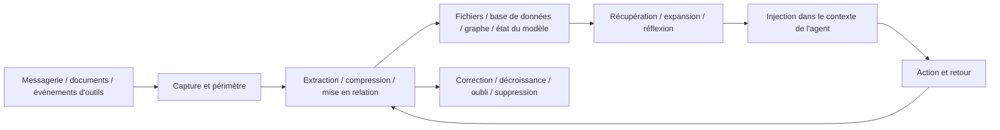

# awesome_agent_memory

**Collection open source de systèmes de mémoire pour agents IA : mémoire fichier, mémoire en graphe, plugins d'assistants de codage, implémentations de recherche et benchmarks.**

Sélection curated de systèmes de mémoire open source, de mémoire à source fichier, de graphes de connaissances temporels, d'intégrations pour agents de codage, de mémoire procédurale et de benchmarks pour agents IA — avec des descriptions liées à des preuves et des classements de maintenance GitHub reproductibles.

La « mémoire » couverte ici suit tout le cycle de vie : capture des interactions, extraction des faits et des expériences, stockage et périmètre, puis récupération, réflexion, correction, oubli, suppression et injection dans l'hôte. Les bases vectoristes ordinaires et les caches court terme limités à la conversation en cours ne sont pas recensés séparément.

[Index par catégorie](#index-par-catégorie) · [Détail des projets](docs/projects.md) · [Vues de classement](docs/rankings.md) · [Méthode](docs/methodology.md) · [Journal de recherche](docs/research.md) · [Contribuer](CONTRIBUTING.md)

Les catégories décrivent la responsabilité principale du projet, pas une exclusivité fonctionnelle. La première version vise une carte vérifiable de l'écosystème ; elle ne prétend pas recenser tous les projets du web.
