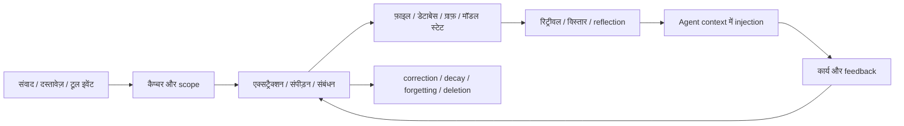

🌐 [English](../../README.md) · [简体中文](../zh/README.md) · [Español](../es/README.md) · **हिन्दी** · [Français](../fr/README.md)

# awesome_agent_memory

**ओपन-सोर्स AI Agent मेमोरी सिस्टम, फ़ाइल मेमोरी, नोलेज-ग्राफ़ मेमोरी, कोडिंग-असिस्टेंट प्लगइन, रिसर्च इम्प्लीमेंटेशन और इवैल्युएशन का क्युरेटेड संग्रह।**

AI Agents के लिए क्युरेटेड ओपन-सोर्स मेमोरी सिस्टम, फ़ाइल-बैक्ड मेमोरी, टेम्पोरल नॉलेज ग्राफ़, कोडिंग-एजेंट इंटीग्रेशन, प्रोसीजरल मेमोरी और benchmark — प्रमाण-लिंक वाले विवरण और दोबारा चलायी जा सकने वाली GitHub मेंटेनेंस रैंकिंग के साथ।

यहाँ "मेमोरी" से तात्पर्य इंटरैक्शन कैप्चर, तथ्य/अनुभव एक्सट्रैक्शन, स्टोरेज और scope से लेकर रिट्रीवल, reflection, correction, forgetting, deletion और होस्ट injection तक की पूरी lifecycle से है। साधारण vector डेटाबेस और केवल वर्तमान संवाद रखने वाले short-term cache अलग से शामिल नहीं किए जाते।

[श्रेणी सूची](#श्रेणी-सूची) · [प्रोजेक्ट विवरण तालिका](docs/projects.md) · [रैंकिंग व्यूज़](docs/rankings.md) · [पद्धति](docs/methodology.md) · [खोज रिकॉर्ड](docs/research.md) · [योगदान](CONTRIBUTING.md)



श्रेणी-वर्ग प्रोजेक्ट के मुख्य दायित्व का वर्णन करते हैं, यह अर्थ नहीं कि क्षमताएँ परस्पर बहिष्कृत हैं। प्रारंभिक संस्करण एक जाँच-योग्य इकोसिस्टम नक्शा बनाना चाहता है; यह दावा नहीं करता कि पूरे वेब के सारे प्रोजेक्ट कवर हो गए हैं।

## श्रेणी पर जाएँ

[मेमोरी इंजन और सर्विसेज़](#मेमोरी-इंजन-और-सर्विसेज़) · [फ़ाइल-आधारित ट्रुथ सोर्स और समीक्षायोग्य मेमोरी](#फ़ाइल-आधारित-ट्रुथ-सोर्स-और-समीक्षायोग्य-मेमोरी) · [ग्राफ़, एंटिटी और टेम्पोरल मेमोरी](#ग्राफ़-एंटिटी-और-टेम्पोरल-मेमोरी) · [कोडिंग Agent और MCP मेमोरी](#कोडिंग-agent-और-mcp-मेमोरी) · [अनुभव, स्किल और प्रोसीजरल मेमोरी](#अनुभव-स्किल-और-प्रोसीजरल-मेमोरी) · [रिसर्च इम्प्लीमेंटेशन और इवैल्युएशन](#रिसर्च-इम्प्लीमेंटेशन-और-इवैल्युएशन) · [संलग्न प्लेटफ़ॉर्म, स्पेसिफ़िकेशन और इंडेक्स](#संलग्न-प्लेटफ़ॉर्म-स्पेसिफ़िकेशन-और-इंडेक्स) · [ऐतिहासिक, आर्काइव्ड और प्रतिबंधित लाइसेंस](#ऐतिहासिक-आर्काइव्ड-और-प्रतिबंधित-लाइसेंस)

## वर्तमान संग्रह

**कुल 89 प्रोजेक्ट, जिनमें से 54 तीन मूल रिपोर्ट्स से आए हैं और 35 इस दौर में जोड़े गए हैं।** फ़ंक्शनल सत्यापन: 2026-11-20; मेट्रिक्स स्नैपशॉट: `2026-11-28T09:29:52+00:00` (UTC)।

हर श्रेणी में पहले मेंटेनेंस स्थिति के अनुसार टियर बनाए जाते हैं, फिर star (40%), 90 दिन की डिफ़ॉल्ट-ब्रांच कमिट (35%) और नवीनतम कमिट (25%) के संयुक्त स्कोर से रैंक किया जाता है। आर्काइव्ड प्रोजेक्ट अंत में रखे जाते हैं। मेंटेनेंस स्कोर केवल GitHub लोकप्रियता और गतिविधि के संकेत का वर्णन करता है; यह मेमोरी सटीकता, लागत, सुरक्षा या प्रोडक्शन परिपक्वता की गारंटी नहीं है।

## सक्रिय मुख्य प्रोजेक्ट का स्नैपशॉट

केवल मुख्य उम्मीदवार, सत्यापित लाइसेंस वाले और पिछले 90 दिनों में कमिट करने वाले प्रोजेक्ट दिखाए जाते हैं; रिसर्च इम्प्लीमेंटेशन, रिट्रीवल घटक, प्रतिबंधित लाइसेंस और ऐतिहासिक प्रोजेक्ट इस तालिका में नहीं आते।

| प्रोजेक्ट | पोज़िशन | Stars | 90-दिन कमिट | नवीनतम कमिट UTC | मेंटेनेंस स्कोर |
| --- | --- | --- | --- | --- | --- |
| [claude-mem](https://github.com/thedotmack/claude-mem) | सेशन और tool गतिविधि कैप्चर कर, उन्हें SQLite/FTS5/Chroma में संकुचित कर आगे के सेशन में recall करता है। | 120,290 | 2,574 | 2026-11-26 | 99.6 |
| [Hindsight](https://github.com/vectorize-io/hindsight) | retain, recall और reflect के ज़रिए संरचित तथ्यों, अनुभवों, एंटिटीज़ और संश्लेषित अवलोकनों को प्रबंधित करता है। | 63,910 | 1,685 | 2026-11-27 | 98.3 |
| [OpenViking](https://github.com/volcengine/OpenViking) | नेविगेट-योग्य वर्चुअल फ़ाइल सिस्टम से संसाधनों, लॉन्ग-टर्म मेमोरी और Agent Skills को एकीकृत रूप में प्रबंधित करता है। | 42,960 | 1,484 | 2026-11-28 | 97.0 |
| [Cognee](https://github.com/topoteretes/cognee) | दस्तावेज़, कोड और बातचीत को एंटिटी-संबंधों तथा सर्च-योग्य knowledge/memory ग्राफ़ में बदलता है। | 33,682 | 3,067 | 2026-11-27 | 96.0 |
| [agentmemory · rohitg00](https://github.com/rohitg00/agentmemory) | कोडिंग Agent के लिए सर्विस और प्लगइन, जो BM25, वैकल्पिक वेक्टर और संरचित संबंधों को जोड़ता है। | 30,645 | 236 | 2026-11-27 | 91.5 |
| [Engram · Gentleman Programming](https://github.com/Gentleman-Programming/engram) | कोडिंग Agent के लिए Go/SQLite/FTS5 पर्सिस्टेंट मेमोरी; MCP, HTTP, CLI और TUI देती है। | 8,336 | 820 | 2026-11-24 | 90.3 |
| [Graphiti](https://github.com/getzep/graphiti) | रियल-टाइम में एंटिटी और संबंध निकालकर bi-temporal नॉलेज ग्राफ़ बनाता है और lexical, vector तथा graph रिट्रीवल कोजोड़ता है करता है. | 33,156 | 164 | 2026-11-27 | 89.7 |
| [Basic Memory](https://github.com/basicmachines-co/basic-memory) | संपादन-योग्य Markdown नोट्स और semantic संबंधों को मनुष्य-Agent साझा ज्ञान-मेमोरी के रूप में इस्तेमाल करता है। | 4,746 | 791 | 2026-11-27 | 89.1 |
| [Mnemosyne · mnemosyne-oss](https://github.com/mnemosyne-oss/mnemosyne) | SQLite-चालित, लोकल-प्रधान क्रॉस-फ़्रेमवर्क मेमोरी लेयर; MCP और कई Agent इंटीग्रेशन। | 3,714 | 922 | 2026-11-28 | 88.5 |
| [Supermemory](https://github.com/supermemoryai/supermemory) | दस्तावेज़ों, मेमोरी और यूज़र प्रोफ़ाइल के लिए हाइब्रिड सर्च और मेमोरी प्लेटफ़ॉर्म। | 31,884 | 130 | 2026-11-28 | 88.4 |
| [Honcho](https://github.com/plastic-labs/honcho) | peer, session और workspace के इर्द-गिर्द निरंतर ऑब्जेक्ट रिप्रज़ेंटेशन और सह-कार्यात्मक समझ गढ़ता है। | 8,319 | 317 | 2026-11-25 | 88.1 |
| [Mem0](https://github.com/mem0ai/mem0) | सामान्य पर्सनलाइज़ेशन मेमोरी लेयर; इंटरैक्शन से मेमोरी निकालना, अद्यतन, विलोपन और रिट्रीवल का समर्थन करती है। | 69,572 | 69 | 2026-11-27 | 87.5 |

## श्रेणी सूची

`★रिपोर्ट बेसलाइन` दर्शाता है कि प्रोजेक्ट उपयोगकर्ता द्वारा प्रदान की गई तीन रिपोर्ट्स में से आता है। हर रिपॉज़िटरी का केवल एक मुख्य श्रेणी-वर्ग होता है, ताकि एक ही रिपॉज़िटरी रैंकिंग में दोहराई न जाए।

| श्रेणी | संख्या | मेंटेनेंस रैंकिंग में अग्रणी प्रोजेक्ट |
| --- | --- | --- |
| मेमोरी इंजन और सर्विसेज़ | 27 | Hindsight, OpenViking, agentmemory · rohitg00 |
| फ़ाइल-आधारित ट्रुथ सोर्स और समीक्षायोग्य मेमोरी | 11 | Engram · Gentleman Programming, Basic Memory, Mnemosyne · mnemosyne-oss |
| ग्राफ़, एंटिटी और टेम्पोरल मेमोरी | 7 | Cognee, Graphiti, CortexDB |
| कोडिंग Agent और MCP मेमोरी | 10 | claude-mem, MCP Memory Service, dsh-mnemon |
| अनुभव, स्किल और प्रोसीजरल मेमोरी | 5 | memU, Mengram, LangMem |
| रिसर्च इम्प्लीमेंटेशन और इवैल्युएशन | 19 | OWASP Agent Memory Guard, Agent Memory Leaderboard, MemT-1.0 |
| संलग्न प्लेटफ़ॉर्म, स्पेसिफ़िकेशन और इंडेक्स | 5 | QMD, Awesome Agent Memory · mnemoverse, Letta / MemGPT |
| ऐतिहासिक, आर्काइव्ड और प्रतिबंधित लाइसेंस | 5 | Engram App, Katra, Zep Legacy Community Edition |

### मेमोरी इंजन और सर्विसेज़

| प्रोजेक्ट | पोज़िशन | Stars | 90-दिन कमिट | नवीनतम कमिट UTC | मेंटेनेंस स्कोर | लाइसेंस |
| --- | --- | --- | --- | --- | --- | --- |
| [Hindsight](https://github.com/vectorize-io/hindsight) · ★रिपोर्ट बेसलाइन | retain, recall और reflect के ज़रिए संरचित तथ्यों, अनुभवों, एंटिटीज़ और संश्लेषित अवलोकनों को प्रबंधित करता है। | 63,910 | 1,685 | 2026-11-27 | 98.3 | MIT |
| [OpenViking](https://github.com/volcengine/OpenViking) · ★रिपोर्ट बेसलाइन | नेविगेट-योग्य वर्चुअल फ़ाइल सिस्टम से संसाधनों, लॉन्ग-टर्म मेमोरी और Agent Skills को एकीकृत रूप में प्रबंधित करता है। | 42,960 | 1,484 | 2026-11-28 | 97.0 | AGPL-3.0 |
| [agentmemory · rohitg00](https://github.com/rohitg00/agentmemory) · ★रिपोर्ट बेसलाइन | कोडिंग Agent के लिए सर्विस और प्लगइन, जो BM25, वैकल्पिक वेक्टर और संरचित संबंधों को जोड़ता है। | 30,645 | 236 | 2026-11-27 | 91.5 | Apache-2.0 |
| [Supermemory](https://github.com/supermemoryai/supermemory) · ★रिपोर्ट बेसलाइन | दस्तावेज़ों, मेमोरी और यूज़र प्रोफ़ाइल के लिए हाइब्रिड सर्च और मेमोरी प्लेटफ़ॉर्म। | 31,884 | 130 | 2026-11-28 | 88.4 | MIT |
| [Honcho](https://github.com/plastic-labs/honcho) · ★रिपोर्ट बेसलाइन | peer, session और workspace के इर्द-गिर्द निरंतर ऑब्जेक्ट रिप्रज़ेंटेशन और सह-कार्यात्मक समझ गढ़ता है। | 8,319 | 317 | 2026-11-25 | 88.1 | AGPL-3.0 |
| [Mem0](https://github.com/mem0ai/mem0) · ★रिपोर्ट बेसलाइन | सामान्य पर्सनलाइज़ेशन मेमोरी लेयर; इंटरैक्शन से मेमोरी निकालना, अद्यतन, विलोपन और रिट्रीवल का समर्थन करती है। | 69,572 | 69 | 2026-11-27 | 87.5 | Apache-2.0 |
| [Hy-Memory](https://github.com/Tencent-Hunyuan/Hy-Memory) | बातचीत, Agent और कोडिंग परिदृश्यों के लिए dual-system cognitive मेमोरी इंजन और Python SDK। | 1,944 | 604 | 2026-11-18 | 83.8 | Apache-2.0 |
| [TencentDB Agent Memory](https://github.com/TencentCloud/TencentDB-Agent-Memory) | बातचीत, दस्तावेज़ और कोड को Chat Memory, Skill, LLM-Wiki और Code-Graph में बदलने वाला टीम मेमोरी सेंटर। | 31,244 | 60 | 2026-11-24 | 83.0 | MIT |
| [MemOS](https://github.com/MemTensor/MemOS) · ★रिपोर्ट बेसलाइन | Agent के लिए मेमोरी ऑपरेटिंग सिस्टम, जो कई श्रेणियों की मेमोरी, हाइब्रिड रिट्रीवल और स्किल इवोल्यूशन को कवर करता है। | 12,527 | 103 | 2026-11-09 | 79.2 | Apache-2.0 |
| [Remnic](https://github.com/joshuaswarren/remnic) | scope, स्रोत, सुधार, सीमा, रिट्रीवल गुणवत्ता और MCP/HTTP पर ज़ोर देने वाली user-aware मेमोरी लेयर। | 235 | 740 | 2026-11-27 | 78.8 | MIT |
| [MemMachine](https://github.com/MemMachine/MemMachine) · ★रिपोर्ट बेसलाइन | यूज़र, प्रोजेक्ट और सेशन आयामों के इंटरफ़ेस वाला सामान्य Agent मेमोरी सर्विस। | 3,095 | 49 | 2026-11-26 | 74.3 | Apache-2.0 |
| [Mnemon](https://github.com/mnemon-dev/mnemon) | Agent के लिए क्रॉस-सेशनpersistent मेमोरी, ज्ञान को ग्राफ़ संरचना में व्यवस्थित करती है; intent-aware रिट्रीवल और कई होस्ट इंटीग्रेशन का समर्थन करती है। | 751 | 121 | 2026-11-23 | 73.8 | Apache-2.0 |
| [openJiuwen Agent Memory](https://github.com/openJiuwen-ai/agent-memory) | Agent के लिए मेमोरी एक्सट्रैक्शन, स्टोरेज, रिट्रीवल, माइग्रेशन और बहु-रूप मेमोरी क्षमताएँ देता है। | 134 | 179 | 2026-11-28 | 71.2 | Apache-2.0 |
| [LongMemory](https://github.com/CaviraOSS/LongMemory) · ★रिपोर्ट बेसलाइन | लोकल TypeScript/SQLite लॉन्ग-टर्म मेमोरी, जो स्रोत, समय, प्रमाण-चयन और token बजट देती है। | 4,596 | 19 | 2026-11-26 | 70.7 | Apache-2.0 |
| [Membase](https://github.com/membaseai/membase) | SDK, CLI और MCP वाला क्रॉस-Agent मेमोरी लेयर; होस्टेड खाता या लोकल स्टोरेज दोनों चुन सकते हैं। | 143 | 168 | 2026-11-25 | 70.3 | MIT |
| [MIRIX](https://github.com/Mirix-AI/MIRIX) · ★रिपोर्ट बेसलाइन | बहु-प्रकार, बहु-Agent, मल्टीमोडल लॉन्ग-टर्म मेमोरी सिस्टम, जो कार्य गतिविधि ट्रैक कर स्किल निहारता है। | 3,521 | 23 | 2026-11-11 | 67.0 | Apache-2.0 |
| [Agent Memory Lab](https://github.com/agent-memory-lab/agent-memory) · ★रिपोर्ट बेसलाइन | स्रोत प्रमाण, तथ्य-सुधार, टाइम वैलिडिटी और scope पर ज़ोर देने वाला मेमोरी इंजन। | 7 | 261 | 2026-11-14 | 60.0 | Apache-2.0 |
| [mem9](https://github.com/mem9-ai/mem9) · ★रिपोर्ट बेसलाइन | क्रॉस-Agent मेमोरी और सेशन इनटेक देता है, साथ ही कई सर्वर-साइड स्टोरेज बैकएंड्स का समर्थन करता है। | 1,236 | 15 | 2026-11-04 | 59.5 | Apache-2.0 |
| [Engram · TAIPANBOX](https://github.com/TAIPANBOX/engram) · ★रिपोर्ट बेसलाइन | SQLite पर episodic, semantic और procedural मेमोरी, bi-temporal तथ्य, decay और MCP रखता है। | 6 | 34 | 2026-11-27 | 51.5 | Apache-2.0 |
| [Memori](https://github.com/MemoriLabs/Memori) · ★रिपोर्ट बेसलाइन | यूज़र और प्रोसेस-ओनरशिप के इर्द-गिर्द मेमोरी इनटेक और recall को मौजूदा LLM कॉल में जोड़ता है। | 17,631 | 2 | 2026-09-18 | 51.5 | Apache-2.0 |
| [Agent MemoryForge](https://github.com/hellangleZ/Agent-MemoryForge) | मल्टी-टेंट Agent के लिए पर्सिस्टेंट, रिट्रीवेबल और ऑडिट-योग्य मेमोरी लेयर, SDK/Gateway के साथ। | 178 | 3 | 2026-09-29 | 38.6 | MIT |
| [Memvid](https://github.com/memvid/memvid) · ★रिपोर्ट बेसलाइन | पोर्टेबल सिंगल-फ़ाइल और Rust कोर से हाइब्रिड रिट्रीवल व बहु-भाषी SDK देता है। | 17,437 | 0 | 2026-07-14 | 39.4 | Apache-2.0 |
| [Memobase](https://github.com/memodb-io/memobase) · ★रिपोर्ट बेसलाइन | यूज़र प्रोफ़ाइल और टाइम्ड इवेंट्स के इर्द-गिर्द लॉन्ग-टर्म यूज़र मेमोरी बनाए रखता है। | 2,968 | 0 | 2026-01-11 | 28.5 | Apache-2.0 |
| [Engram · HBarefoot](https://github.com/HBarefoot/engram) · ★रिपोर्ट बेसलाइन | इन-प्रोसेस TypeScript/SQLite मेमोरी लाइब्रेरी, जो लोकल embedding, MCP और उपयोग-योग्य Skill देती है। | 9 | 0 | 2026-07-07 | 13.0 | MIT |
| [agent-memory · ivanzwb](https://github.com/ivanzwb/agent-memory) · ★रिपोर्ट बेसलाइन | TypeScript एम्बेडेड मेमोरी लाइब्रेरी, जिसमें वर्किंग, सेशन, लॉन्ग-टर्म मेमोरी और नॉलेज-बेस शामिल हैं। | 4 | 0 | 2026-04-13 | 7.5 | MIT |
| [MEMANTO](https://github.com/Jahvis/memanto-ai-memory) · ★रिपोर्ट बेसलाइन | remember, recall और answer प्रिमिटिव्स में संस्करण और स्रोत मेटाडेटा वाली मेमोरी सर्विस लपेटता है। | 1 | 0 | 2026-06-05 | 6.0 | MIT |
| [OpenMemory · tawanorg](https://github.com/tawanorg/OpenMemory) | फ़्रेमवर्क-अपेक्षित, self-hosted लॉन्ग-टर्म semantic और context मेमोरी सर्विस। | 1 | 0 | 2025-10-26 | 2.7 | MIT |

### फ़ाइल-आधारित ट्रुथ सोर्स और समीक्षायोग्य मेमोरी

| प्रोजेक्ट | पोज़िशन | Stars | 90-दिन कमिट | नवीनतम कमिट UTC | मेंटेनेंस स्कोर | लाइसेंस |
| --- | --- | --- | --- | --- | --- | --- |
| [Engram · Gentleman Programming](https://github.com/Gentleman-Programming/engram) | कोडिंग Agent के लिए Go/SQLite/FTS5 पर्सिस्टेंट मेमोरी; MCP, HTTP, CLI और TUI देती है। | 8,336 | 820 | 2026-11-24 | 90.3 | MIT |
| [Basic Memory](https://github.com/basicmachines-co/basic-memory) · ★रिपोर्ट बेसलाइन | संपादन-योग्य Markdown नोट्स और semantic संबंधों को मनुष्य-Agent साझा ज्ञान-मेमोरी के रूप में इस्तेमाल करता है। | 4,746 | 791 | 2026-11-27 | 89.1 | AGPL-3.0 |
| [Mnemosyne · mnemosyne-oss](https://github.com/mnemosyne-oss/mnemosyne) | SQLite-चालित, लोकल-प्रधान क्रॉस-फ़्रेमवर्क मेमोरी लेयर; MCP और कई Agent इंटीग्रेशन। | 3,714 | 922 | 2026-11-28 | 88.5 | MIT |
| [EverOS](https://github.com/EverMind-AI/EverOS) · ★रिपोर्ट बेसलाइन | Markdown ट्रुथ सोर्स और लोकल इंडेक्स से यूज़र episodes/profile और Agent cases/skills प्रबंधित करता है। | 14,019 | 122 | 2026-11-25 | 84.5 | Apache-2.0 |
| [agent-memory · tigerless](https://github.com/tigerless-labs/agent-memory) · ★रिपोर्ट बेसलाइन | Markdown को ट्रुथ सोर्स, SQLite को पुनर्निर्माण-योग्य इंडेक्स रखता है, और एक स्वतंत्र sleep-ऑर्गनाइज़ेशन लेयर देता है। | 3,966 | 381 | 2026-11-12 | 83.2 | MIT |
| [ReMe](https://github.com/agentscope-ai/ReMe) · ★रिपोर्ट बेसलाइन | Markdown/frontmatter/wikilinks से तथ्य और अनुभव व्यवस्थित करता है; lexical, vector और संबंध-विस्तार का समर्थन। | 3,860 | 187 | 2026-11-26 | 82.6 | Apache-2.0 |
| [MemSearch](https://github.com/zilliztech/memsearch) · ★रिपोर्ट बेसलाइन | Markdown ट्रुथ सोर्स के साथ Milvus derived इंडेक्स; vector/BM25/RRF और progressive expansion का समर्थन। | 2,958 | 68 | 2026-11-27 | 76.3 | MIT |
| [Sibyl Memory](https://github.com/Sibyl-Labs/Sibyl-Memory) | सिंगल-फ़ाइल, बिना vector-DB लॉन्ग-टर्म मेमोरी परिवार; SDK, CLI, MCP, Hermes और LangGraph एडॉप्टर शामिल। | 191 | 40 | 2026-11-19 | 61.9 | MIT |
| [Agent Memory Vault](https://github.com/mcncarl/agent-memory-vault) | Markdown-प्रधान Claude Code/Codex साझा मेमोरी वॉल्ट, Git, इंडेक्स और audit के साथ। | 350 | 4 | 2026-10-04 | 43.0 | MIT |
| [Engram · shiblon](https://github.com/shiblon/engram) · ★रिपोर्ट बेसलाइन | सिंगल बाइनरी और SQLite से short/long-term मेमोरी, प्राथमिकताएँ और persona प्रबंधित करता है। | 19 | 24 | 2026-10-06 | 42.4 | Apache-2.0 |
| [Engram · B12Labs](https://github.com/B12Labs/engram) · ★रिपोर्ट बेसलाइन | पोर्टेबल सिंगल-फ़ाइल मेमोरी फ़ॉर्मैट, graph compression और fast/hybrid/deep सर्च के साथ। | 1 | 0 | 2026-04-15 | 4.4 | MIT |

### ग्राफ़, एंटिटी और टेम्पोरल मेमोरी

| प्रोजेक्ट | पोज़िशन | Stars | 90-दिन कमिट | नवीनतम कमिट UTC | मेंटेनेंस स्कोर | लाइसेंस |
| --- | --- | --- | --- | --- | --- | --- |
| [Cognee](https://github.com/topoteretes/cognee) · ★रिपोर्ट बेसलाइन | दस्तावेज़, कोड और बातचीत को एंटिटी-संबंधों तथा सर्च-योग्य knowledge/memory ग्राफ़ में बदलता है। | 33,682 | 3,067 | 2026-11-27 | 96.0 | Apache-2.0 |
| [Graphiti](https://github.com/getzep/graphiti) · ★रिपोर्ट बेसलाइन | रियल-टाइम में एंटिटी और संबंध निकालकर bi-temporal नॉलेज ग्राफ़ बनाता है और lexical, vector तथा graph रिट्रीवल कोजोड़ता है करता है. | 33,156 | 164 | 2026-11-27 | 89.7 | Apache-2.0 |
| [CortexDB](https://github.com/liliang-cn/cortexdb) | एक ही SQLite फ़ाइल में नॉलेज ग्राफ़, constraints और traceable reasoning जोड़ता है। | 533 | 588 | 2026-11-27 | 81.5 | MIT |
| [Neo4j Agent Memory](https://github.com/neo4j-labs/agent-memory) | ग्राफ़-आधारित Agent मेमोरी और context graph, जो संवाद, एंटिटी, संबंध और reasoning traces स्टोर करता है। | 617 | 201 | 2026-10-27 | 69.8 | Apache-2.0 |
| [Memoir](https://github.com/zhangfengcdt/memoir) | Git-शैली version control वाली लेयर्ड Agent मेमोरी। | 648 | 33 | 2026-10-27 | 59.8 | Apache-2.0 |
| [Lemmalog](https://github.com/JordyZomer/lemmalog) | Datalog नियम, स्रोत-तथ्य और incremental derivation से Agent मेमोरी बनाता है। | 352 | 28 | 2026-10-01 | 52.5 | MIT |
| [Memory Graph](https://github.com/memory-graph/memory-graph) | कोडिंग Agent के लिए संबंध-ट्रैकिंग और ग्राफ़ क्वेरी वाला MCP मेमोरी सर्विस। | 260 | 3 | 2026-09-16 | 38.3 | MIT |

### कोडिंग Agent और MCP मेमोरी

| प्रोजेक्ट | पोज़िशन | Stars | 90-दिन कमिट | नवीनतम कमिट UTC | मेंटेनेंस स्कोर | लाइसेंस |
| --- | --- | --- | --- | --- | --- | --- |
| [claude-mem](https://github.com/thedotmack/claude-mem) · ★रिपोर्ट बेसलाइन | सेशन और tool गतिविधि कैप्चर कर, उन्हें SQLite/FTS5/Chroma में संकुचित कर आगे के सेशन में recall करता है। | 120,290 | 2,574 | 2026-11-26 | 99.6 | Apache-2.0 |
| [MCP Memory Service](https://github.com/doobidoo/mcp-memory-service) · ★रिपोर्ट बेसलाइन | MCP/REST से semantic मेमोरी, संबंध और बैकग्राउंड ऑर्गनाइज़ेशन देता है; कई स्टोरेज बैकएंड्स समर्थित। | 2,164 | 724 | 2026-11-27 | 86.5 | Apache-2.0 |
| [dsh-mnemon](https://github.com/omdsh-dev/dsh-mnemon) | DeepSeek Harness का लेयर्ड मेमोरी प्लगइन, जो रनटाइम मेमोरी, प्रोजेक्ट दस्तावेज़ और स्वैच-योग्य लॉन्ग-टर्म मेमोरी बैकएंड्स को जोड़ता है। | 1,152 | 1,660 | 2026-11-26 | 84.0 | MIT |
| [Memorix](https://github.com/AVIDS2/memorix) | MCP से कई कोडिंग Agent के बीच क्रॉस-होस्ट साझा मेमोरी देता है। | 954 | 178 | 2026-11-27 | 77.8 | Apache-2.0 |
| [OKF Agent Memory](https://github.com/okf-memory/okf-agent-memory) | Git-native कोडिंग Agent मेमोरी; एम्बेडेड MCP और progressive reading के साथ। | 878 | 247 | 2026-11-21 | 77.7 | MIT |
| [projectmem](https://github.com/riponcm/projectmem) · ★रिपोर्ट बेसलाइन | event log में issue, प्रयास, fix और निर्णय दर्ज करता है, ताकि कोडिंग Agent दोहराई गई त्रुटियाँ न करें. | 886 | 135 | 2026-11-28 | 76.2 | MIT |
| [Mnemoverse Memory Server](https://github.com/mnemoverse/mcp-memory-server) | MCP से होस्टेड पर्सिस्टेंट मेमोरी, feedback reranking और मल्टी-Agent साझा कमरे। | 30 | 142 | 2026-11-18 | 62.4 | MIT |
| [Codex Honcho](https://github.com/plastic-labs/codex-honcho) · ★रिपोर्ट बेसलाइन | Codex सेशन, tool गतिविधि और context injection को Honcho से जोड़ने का आधिकारिक इंटीग्रेशन। | 66 | 1 | 2026-09-01 | 28.0 | MIT |
| [MegaMemory](https://github.com/0xK3vin/MegaMemory) | कोडिंग Agent के लिए पर्सिस्टेंट प्रोजेक्ट नॉलेज ग्राफ़, semantic सर्च और MCP सर्विस। | 738 | 0 | 2026-05-03 | 25.4 | MIT |
| [mcp-mem0](https://github.com/coleam00/mcp-mem0) | Mem0 की लॉन्ग-टर्म मेमोरी को MCP सर्विस के रूप में Agent क्लाइंट्स तक पहुँचाता है। | 686 | 0 | 2025-04-13 | 22.7 | MIT |

### अनुभव, स्किल और प्रोसीजरल मेमोरी

| प्रोजेक्ट | पोज़िशन | Stars | 90-दिन कमिट | नवीनतम कमिट UTC | मेंटेनेंस स्कोर | लाइसेंस |
| --- | --- | --- | --- | --- | --- | --- |
| [memU](https://github.com/NevaMind-AI/memU) · ★रिपोर्ट बेसलाइन | क्रॉस-Agent व्यक्तिगत मेमोरी और होस्ट bridge; Agent द्वारा Markdown निष्कर्षण और मेमोरी Skill का समर्थन। | 14,648 | 65 | 2026-11-27 | 81.6 | Apache-2.0 |
| [Mengram](https://github.com/alibaizhanov/mengram) · ★रिपोर्ट बेसलाइन | semantic, episodic और procedural मेमोरी व्यवस्थित करता है, और विफलता-प्रतिक्रिया से कार्यप्रवाह सुधारता है। | 207 | 83 | 2026-11-09 | 63.8 | Apache-2.0 |
| [LangMem](https://github.com/langchain-ai/langmem) · ★रिपोर्ट बेसलाइन | संवाद से लॉन्ग-टर्म तथ्य निकालता है, मेमोरी खोजता है, और अनुभवों से Agent व्यवहार अनुकूलित करता है। | 1,793 | 13 | 2026-11-16 | 62.8 | MIT |
| [Engram · vincents-ai](https://github.com/vincents-ai/engram) · ★रिपोर्ट बेसलाइन · लाइसेंस सूचना | मल्टी-Agent के लिए distributed प्रोजेक्ट context, कार्य, reasoning और टीम ज्ञान। | 25 | 9 | 2026-11-17 | 46.5 | AGPL-3.0-or-later या कमर्शियल लाइसेंस |
| [Acontext](https://github.com/memodb-io/Acontext) · ★रिपोर्ट बेसलाइन · आर्काइव्ड/ऐतिहासिक | Agent execution और artifacts से पठनीय, संपादन-योग्य operating अनुभव और Skill निहारता है। | 3,697 | 2 | 2026-10-24 | 51.7 | Apache-2.0 |

### रिसर्च इम्प्लीमेंटेशन और इवैल्युएशन

| प्रोजेक्ट | पोज़िशन | Stars | 90-दिन कमिट | नवीनतम कमिट UTC | मेंटेनेंस स्कोर | लाइसेंस |
| --- | --- | --- | --- | --- | --- | --- |
| [OWASP Agent Memory Guard](https://github.com/OWASP/www-project-agent-memory-guard) | Agent मेमोरी और context poisoning के लिए runtime रक्षा और reference इम्प्लीमेंटेशन। | 214 | 246 | 2026-11-28 | 74.6 | Apache-2.0 |
| [Agent Memory Leaderboard](https://github.com/AML-memory/agent-memory-leaderboard) · लाइसेंस सूचना | Agent मेमोरी सिस्टम्स के इवैल्युएशन नतीजे और तुलना-सामग्री एकत्र करता है। | 1,311 | 4 | 2026-11-27 | 58.7 | सत्यापन प्रतीक्षित |
| [MemT-1.0](https://github.com/MemTensor/MemT-1.0) · लाइसेंस सूचना | मॉडल-नेटिव मेमोरी read/write और Mixture-of-Storage की जाँच करने वाला मेमोरी मॉडल परिवार। | 618 | 7 | 2026-11-20 | 56.9 | PolyForm Noncommercial-1.0.0 |
| [Agent Memory Benchmarks](https://github.com/RonsenbergVI/agent-memory-benchmarks) | LongMemEval, LoCoMo जैसे Agent मेमोरी सिस्टम्स के लिए खुला इवैल्युएशन और reference इम्प्लीमेंटेशन देता है। | 2 | 187 | 2026-11-09 | 53.6 | MIT |
| [MemForest · Concyclics](https://github.com/Concyclics/MemForest) · ★रिपोर्ट बेसलाइन | लेयर्ड टाइम इंडेक्स से लॉन्ग-टर्म मेमोरी व्यवस्थित करता है और Python प्रयोगात्मक इंटरफ़ेस देता है। | 37 | 10 | 2026-11-11 | 46.9 | MIT |
| [MemSkill](https://github.com/ViktorAxelsen/MemSkill) | एक्सट्रैक्शन, consolidation, pruning जैसे मेमोरी ऑपरेशन्स को सीखने-योग्य, विकसित होने-योग्य Skill के रूप में मॉडल करता है। | 609 | 3 | 2026-10-01 | 43.2 | Apache-2.0 |
| [MemoryAgentBench](https://github.com/HUST-AI-HYZ/MemoryAgentBench) · ★रिपोर्ट बेसलाइन | incremental बहु-चर्या बातचीत से Agent मेमोरी के निर्माण और उपयोग की क्षमता परखता है। | 491 | 3 | 2026-09-25 | 41.6 | MIT |
| [MemForest · EventTree](https://github.com/Celina-love-sweet/MemForest) · ★रिपोर्ट बेसलाइन | EventTree विभाजन, progressive merge और compression से लॉन्ग-टर्म मेमोरी संभालता है। | 66 | 4 | 2026-09-17 | 34.9 | MIT |
| [T-Mem](https://github.com/Sherlockwz/T-Mem) · ★रिपोर्ट बेसलाइन | लेखन के समय भविष्य की query triggers के लिए clues उत्पन्न करता है; तथ्य और scene इंडेक्स जोड़कर associative recall शोधता है. | 200 | 2 | 2026-09-09 | 34.9 | MIT |
| [MemoryStackBench](https://github.com/aetna000/MemoryStackBench) | Agent मेमोरी की सुरक्षा, प्रमाण, डिलीशन-पूर्णता और auditability का स्वचालित मूल्यांकन। | 6 | 6 | 2026-09-11 | 28.2 | Apache-2.0 |
| [Agent Memory Radar](https://github.com/H20Zhang/Agent-Memory-Radar) · लाइसेंस सूचना | मेमोरी तंत्र, benchmark, दूषण, forgetting और recovery के प्रमाण एकत्र करने वाला रिसर्च रडार। | 3 | 6 | 2026-09-11 | 26.2 | CC-BY-4.0 कंटेंट / MIT कोड |
| [SimpleMem](https://github.com/aiming-lab/SimpleMem) · ★रिपोर्ट बेसलाइन | semantic संरचित संपीड़न, मेमोरी consolidation और adaptive retrieval पर शोध। | 3,883 | 0 | 2026-07-24 | 34.8 | MIT |
| [MemoryOS](https://github.com/BAI-LAB/MemoryOS) · ★रिपोर्ट बेसलाइन | short, medium और long-term लेयर्ड मेमोरी, अद्यतन और यूज़र प्रोफ़ाइल प्रबंधन पर शोध। | 1,630 | 0 | 2026-07-07 | 30.8 | Apache-2.0 |
| [A-MEM](https://github.com/agiresearch/A-mem) · ★रिपोर्ट बेसलाइन | Zettelkasten से प्रेरित होकर मेमोरी नोट्स को स्वतः व्यवस्थित, जोड़ और विकसित करता है। | 1,220 | 0 | 2025-12-12 | 25.2 | MIT |
| [agentmemory · JordanMcCann](https://github.com/JordanMcCann/agentmemory) · ★रिपोर्ट बेसलाइन | semantic, lexical, ग्राफ़, importance और समय सहित बहु-संकेत रिट्रीवल पर शोध। | 46 | 0 | 2026-03-26 | 15.0 | MIT |
| [MPBench](https://github.com/Digital-Trust-Lab/mp-bench) | स्थायी मेमोरी लेखन, आगे retrieval और व्यवहार-trigger वाले memory poisoning attack का इवैल्युएशन डेटासेट। | 7 | 0 | 2026-06-28 | 11.8 | Apache-2.0 |
| [agent-memory-bench](https://github.com/thomasfevre/agent-memory-bench) · लाइसेंस सूचना | प्रमाण-हिट, उत्तर और retrieval व्यवहार पर केंद्रित पुनरुत्पादनीय मेमोरी इवैल्युएशन। | 0 | 0 | 2026-07-30 | 6.5 | सत्यापन प्रतीक्षित |
| [MemEngine](https://github.com/nuster1128/MemEngine) · ★रिपोर्ट बेसलाइन · लाइसेंस सूचना | मॉड्यूलर Agent मेमोरी रिसर्च लाइब्रेरी; कई मेमोरी मॉड्यूल और इवैल्युएशन कवर करती है। | 117 | 0 | 2025-05-13 | 16.6 | सत्यापन प्रतीक्षित |
| [MemoryBank / SiliconFriend](https://github.com/zhongwanjun/MemoryBank-SiliconFriend) · ★रिपोर्ट बेसलाइन · आर्काइव्ड/ऐतिहासिक | लंबी बातचीत, यूज़र प्रोफ़ाइल, मेमोरी सुदृढ़ीकरण और forgetting के शुरुआती रिसर्च इम्प्लीमेंटेशन। | 456 | 0 | 2023-05-24 | 21.3 | MIT |

### संलग्न प्लेटफ़ॉर्म, स्पेसिफ़िकेशन और इंडेक्स

| प्रोजेक्ट | पोज़िशन | Stars | 90-दिन कमिट | नवीनतम कमिट UTC | मेंटेनेंस स्कोर | लाइसेंस |
| --- | --- | --- | --- | --- | --- | --- |
| [QMD](https://github.com/tobi/qmd) · ★रिपोर्ट बेसलाइन | लोकल Markdown और दस्तावेज़ों के लिए BM25, vector, query expansion, rerank और MCP। | 31,676 | 130 | 2026-11-20 | 86.5 | MIT |
| [Awesome Agent Memory · mnemoverse](https://github.com/mnemoverse/awesome-agent-memory) | Agent मेमोरी सिस्टम्स, फ़्रेमवर्क, benchmark और रिसर्च का बाहरी इंडेक्स। | 68 | 92 | 2026-11-27 | 65.0 | CC0-1.0 |
| [Letta / MemGPT](https://github.com/letta-ai/letta) · ★रिपोर्ट बेसलाइन | पर्सिस्टेंट स्टेट और Agent-स्वशासित context प्रबंधन पर केंद्रित पूर्ण Agent प्लेटफ़ॉर्म। | 25,572 | 4 | 2026-10-18 | 60.3 | Apache-2.0 |
| [MineContext](https://github.com/volcengine/MineContext) · ★रिपोर्ट बेसलाइन | स्क्रीन जैसे digital context से गतिविधि, सारांश और क्वेरी-योग्य सामग्री उत्पन्न करता है। | 5,559 | 0 | 2026-05-07 | 32.5 | Apache-2.0 |
| [MCP Memory Server](https://github.com/modelcontextprotocol/servers) · ★रिपोर्ट बेसलाइन · आर्काइव्ड/ऐतिहासिक · लाइसेंस सूचना | आधिकारिक MCP servers पैरेंट रिपॉज़िटरी के entities, relations और observations मेमोरी घटक। | 92,309 | 1,221 | 2026-11-27 | 99.5 | Apache-2.0 / MIT संक्रमण; दस्तावेज़ CC-BY-4.0 |

### ऐतिहासिक, आर्काइव्ड और प्रतिबंधित लाइसेंस

| प्रोजेक्ट | पोज़िशन | Stars | 90-दिन कमिट | नवीनतम कमिट UTC | मेंटेनेंस स्कोर | लाइसेंस |
| --- | --- | --- | --- | --- | --- | --- |
| [Engram App](https://github.com/engram-app/Engram) · ★रिपोर्ट बेसलाइन · लाइसेंस सूचना | cognitive मेमोरी और Agent इंटीग्रेशन वाला source-available परियोजना। | 2 | 741 | 2026-11-27 | 63.6 | PolyForm Small Business-1.0.0 / कमर्शियल लाइसेंस |
| [Katra](https://github.com/kolegadev/Katra-Agentic-Memory) · लाइसेंस सूचना | episodic, semantic, ग्राफ़ और sleep-आधारित consolidation वाला MCP cognitive मेमोरी डिवाइस। | 9 | 119 | 2026-10-29 | 52.9 | BSL-1.1 |
| [Zep Legacy Community Edition](https://github.com/getzep/zep) · ★रिपोर्ट बेसलाइन · आर्काइव्ड/ऐतिहासिक | Zep का पुराना Community Edition और वर्तमान क्लाउड प्रोडक्ट इंटीग्रेशन उदाहरण। | 5,025 | 26 | 2026-11-17 | 70.4 | Apache-2.0 |
| [Engram · Agentscreator](https://github.com/Agentscreator/engram-memory) · ★रिपोर्ट बेसलाइन · आर्काइव्ड/ऐतिहासिक | मल्टी-Agent साझा मेमोरी, संघर्ष और consistency के लिए आर्काइव्ड परियोजना। | 82 | 0 | 2026-05-23 | 18.4 | Apache-2.0 |
| [EverMemOS_bz](https://github.com/beizhangnina/EverMemOS_bz) · आर्काइव्ड/ऐतिहासिक | EverMemOS का fork रिपॉज़िटरी, जिसमें बातचीत से निष्कर्षण, संरचित मेमोरी और बहु-रणनीति रिकॉल पर केंद्रित पुराना इम्प्लीमेंटेशन सुरक्षित है। | 1 | 0 | 2025-11-28 | 2.8 | Apache-2.0 |

## चयन प्रवेश-बिंदु

- पूर्ण एक्सटर्नल मेमोरी API चाहिए: पहले मेमोरी इंजन और सर्विसेज़ देखें।
- सीधे संपादन, स्थानांतरण और Git-प्रबंधन योग्य मेमोरी चाहिए: फ़ाइल-आधारित ट्रुथ सोर्स देखें।
- एंटिटी संबंध, टाइम वैलिडिटी और मल्टी-हॉप चाहिए: ग्राफ़ और टेम्पोरल मेमोरी देखें।
- Claude Code, Codex, OpenCode जैसे होस्ट्स के बीच मेमोरी चाहिए: कोडिंग Agent/MCP देखें।
- सफलता और असफलता को पुनःप्रयोज्य विधियों में बदलना चाहिए: अनुभव, स्किल और प्रोसीजरल मेमोरी देखें।
- प्रभाव, दूषण, विलोपन और भूलने की जाँच करनी चाहिए: रिसर्च इम्प्लीमेंटेशन और इवैल्युएशन देखें।

पूरी सीमाएँ और प्रमाण [प्रोजेक्ट विवरण तालिका](docs/projects.md) में, श्रेणी मानदंड [दायरा और श्रेणीकरण](docs/taxonomy.md) में हैं।

## डेटा और मेंटेनेंस

- [समग्र, Star, सक्रियता और नवीनतम कमिट रैंकिंग](docs/rankings.md)
- [रैंकिंग विधि और सीमाएँ](docs/methodology.md)
- [खोज कीवर्ड, स्रोत और कवरेज](docs/research.md)
- [प्रोजेक्ट JSON](../../data/projects.json) · [मेट्रिक्स JSON](../../data/metrics.json) · [रैंकिंग CSV](../../data/rankings.csv)
- [योगदान गाइड](CONTRIBUTING.md)

```sh
python scripts/refresh_metrics.py
python scripts/build.py
python -m unittest discover -s tests -v
python scripts/build.py --check
```

GitHub Actions हर दिन GitHub मेट्रिक्स रिफ्रेश करता है। नए प्रोजेक्ट, फ़ंक्शन, श्रेणी और लाइसेंस निर्णयों का मैन्युअल सत्यापन अनिवार्य है।

## लाइसेंस और आभार

इस डायरेक्टरी के मौलिक संग्रहण और स्क्रिप्ट्स [MIT](../../LICENSE) के अंतर्गत हैं; लिंक किए गए प्रोजेक्ट अपने-अपने लाइसेंस से चलते हैं। अज्ञात, मिश्रित, नॉन-कमर्शियल या BSL/PolyForm परियोजनाओं की मूल सीमाएँ यथावत् रखी गई हैं।

प्रारंभिक वर्गीकरण और प्रोजेक्ट नक्शा उपयोगकर्ता द्वारा प्रदान की गई तीन स्थानीय रिपोर्ट्स से आता है; इस दौर में कवरेज जाँच के लिए [mnemoverse/awesome-agent-memory](https://github.com/mnemoverse/awesome-agent-memory) से भी संदर्भ लिया गया, और हर निर्णय को प्रोजेक्ट के आधिकारिक रिपॉज़िटरी पर जाँचा गया।

[परिवर्तन रिकॉर्ड](../../record/) सत्यापन के समय का मूल पाठ (चीनी में) सुरक्षित रखता है, ताकि हर निर्णय का स्रोत और उस समय की शब्दावली ऑडिट की जा सके।
