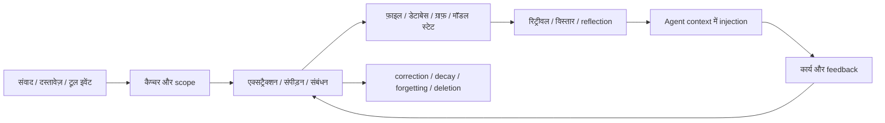

# awesome_agent_memory

**ओपन-सोर्स AI Agent मेमोरी सिस्टम, फ़ाइल मेमोरी, नोलेज-ग्राफ़ मेमोरी, कोडिंग-असिस्टेंट प्लगइन, रिसर्च इम्प्लीमेंटेशन और इवैल्युएशन का क्युरेटेड संग्रह।**

AI Agents के लिए क्युरेटेड ओपन-सोर्स मेमोरी सिस्टम, फ़ाइल-बैक्ड मेमोरी, टेम्पोरल नॉलेज ग्राफ़, कोडिंग-एजेंट इंटीग्रेशन, प्रोसीजरल मेमोरी और benchmark — प्रमाण-लिंक वाले विवरण और दोबारा चलायी जा सकने वाली GitHub मेंटेनेंस रैंकिंग के साथ।

यहाँ "मेमोरी" से तात्पर्य इंटरैक्शन कैप्चर, तथ्य/अनुभव एक्सट्रैक्शन, स्टोरेज और scope से लेकर रिट्रीवल, reflection, correction, forgetting, deletion और होस्ट injection तक की पूरी lifecycle से है। साधारण vector डेटाबेस और केवल वर्तमान संवाद रखने वाले short-term cache अलग से शामिल नहीं किए जाते।

[श्रेणी सूची](#श्रेणी-सूची) · [प्रोजेक्ट विवरण तालिका](docs/projects.md) · [रैंकिंग व्यूज़](docs/rankings.md) · [पद्धति](docs/methodology.md) · [खोज रिकॉर्ड](docs/research.md) · [योगदान](CONTRIBUTING.md)

श्रेणी-वर्ग प्रोजेक्ट के मुख्य दायित्व का वर्णन करते हैं, यह अर्थ नहीं कि क्षमताएँ परस्पर बहिष्कृत हैं। प्रारंभिक संस्करण एक जाँच-योग्य इकोसिस्टम नक्शा बनाना चाहता है; यह दावा नहीं करता कि पूरे वेब के सारे प्रोजेक्ट कवर हो गए हैं।
